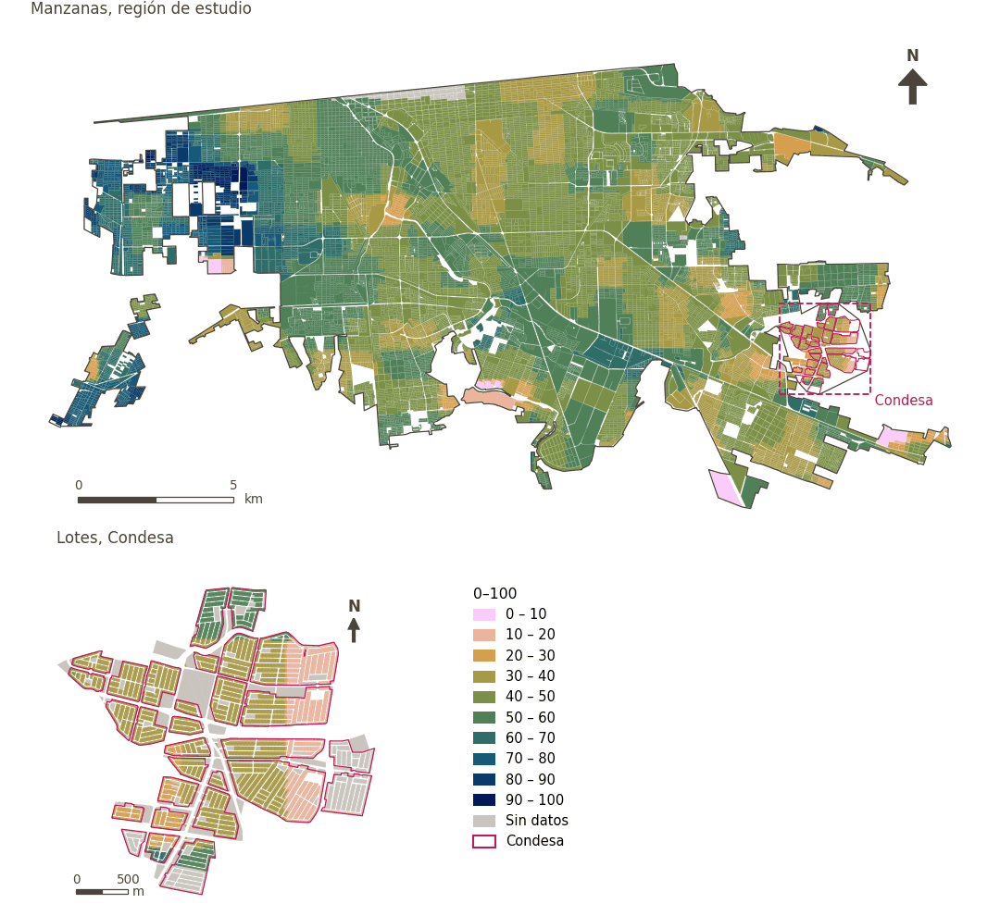

# Exposición al calor (GUHVI)

[← Volver al contenido](../README.md)

> Subíndice de exposición al calor del GUHVI (0-100), a partir de la temperatura de la superficie terrestre; menor es mejor.

## Identificación

| | |
|---|---|
| Identificador | `heat_exposure` |
| Medida central (hoja de variables) | Índice Global de Vulnerabilidad Urbana al Calor (GUHVI) |
| ID de la hoja / registro | 382 · #382 |
| Variable en puntos de muestra | `sp_urban_heat_exposure_index` |
| Variable de área (valor medido) | `urban_heat_exposure_index` (0–100) |
| Puntuación normalizada | `index_uli__heat_exposure` |
| Dominios (parte del peso) | [Entorno medioambiental](domain_ambient_environment.md) |
| Subdominio | Riesgos climáticos |
| Enfoque | Calidad |
| Mejor si es | menor |
| Peso efectivo en el índice | `uli` 2.8% · `uli_plain` 2.4% |
| Estado | Se puntúa en el índice publicado |

## Justificación e interpretación

> Mitigar el efecto de isla de calor urbana mediante la reducción de los aumentos locales de temperatura promueve el confort térmico y favorece el bienestar físico y mental de los habitantes. (traducción preliminar del inglés)
>
> — *Registro de indicadores #382: Urban heat island (Ambient Environment / Risks)*

- Cita del libro de trabajo: Leya et al., 2022, 'Spatial Variations of Urban Heat Island Development in Khulna City, Bangladesh: Implications for Urban Planning and Development'
- Lista de artículos: #18: Jodder (2024), ‘Urban Livability in a Rapidly Urbanizing Mid-Size City: Lessons for Planning in the Global South’
- ⚠ la cita del libro de trabajo no nombra a un autor del artículo de la lista; verifique antes de citar (citation_audit.csv)

**Cómo leerlo.** Índice de exposición al calor de … (0-100; menor es mejor).

**Heat exposure** (Global Urban Heat Vulnerability Index (GUHVI); ID 382) (en inglés en la hoja)
- *Cómo calcular (hoja de variables):* USE GHSCI CALCULATION HERE (Land Surface Temperature)

## Fuentes de datos

**Fuentes declaradas en la configuración:**

- Turner et al. (2025) Urban Climate 64, 102716; computed in Google Earth Engine by GHSCI.

**Insumos:** [Índice Global de Vulnerabilidad Urbana al Calor (GUHVI) y sus insumos](guhvi.md)

## Método: teoría

1. Subíndice del Índice Global de Vulnerabilidad Urbana al Calor (GUHVI; Turner et al. 2025) calculado en Google Earth Engine sobre una cuadrícula de análisis, normalizado mín.–máx. a 0–100 dentro de la región (R8).
2. Cada punto de muestra toma el valor de la celda que lo contiene.
3. Normalización AMPI (R11) con metas fijas de 0 y 100 (la propia escala del subíndice), agregación (R12) y áreas (R13).

## Método: práctica

**Recetas:** [R1. Puntos de muestra y red peatonal](../03_recipes.md#r1), [R8. Earth Engine: vulnerabilidad al calor y grandes espacios verdes](../03_recipes.md#r8), [R11. Normalización: el Índice Ajustado de Mazziotta–Pareto (AMPI)](../03_recipes.md#r11), [R12. Agregación: dominios, indicadores compartidos e índice](../03_recipes.md#r12), [R13. De los puntos de muestra a las áreas](../03_recipes.md#r13), [R14. Metas congeladas y recálculo de un escenario](../03_recipes.md#r14)

**Configuración** ([`MX_Mexicali_2025_ULI.yml:1217`](../../data/MX_Mexicali_2025_ULI.yml#L1217)):

```yaml
- variable: sp_urban_heat_exposure_index
  name: heat_exposure
  domains: [ambient_environment]
  polarity: negative
  goalposts: {min: 0, max: 100}
  lens: quality
  group: {es: 'Índice Global de Vulnerabilidad Urbana al Calor (GUHVI)', en: 'Global Urban Heat Vulnerability Index (GUHVI)'}
  label: {es: 'Exposición al calor (GUHVI)', en: 'Heat exposure (GUHVI)'}
  reading: {es: 'Índice de exposición al calor de {value} (0-100; menor es mejor)', en: 'Heat exposure index of {value} (0-100; lower is better)'}
  subdomain: {es: 'Riesgos climáticos', en: 'Climate risks'}
  about:
    es: Subíndice de exposición al calor del GUHVI (0-100), a partir de la temperatura de la superficie terrestre; menor es mejor.
    en: The GUHVI's heat exposure sub-index (0-100), from land surface temperature; lower is better.
  sources:
    - 'Turner et al. (2025) Urban Climate 64, 102716; computed in Google Earth Engine by GHSCI.'
```

**Código (GHSCI):**

- [`process/subprocesses/_earth_engine_indicators.py:846`](https://github.com/healthysustainablecities/global-indicators/blob/f03909611dba336c2728fffab6d697779487d0b1/process/subprocesses/_earth_engine_indicators.py#L846) `guhvi_analysis()`
- [`process/subprocesses/_earth_engine_indicators.py:1105`](https://github.com/healthysustainablecities/global-indicators/blob/f03909611dba336c2728fffab6d697779487d0b1/process/subprocesses/_earth_engine_indicators.py#L1105) `normalise_band()`
- [`process/subprocesses/_composite_index.py:1819`](https://github.com/healthysustainablecities/global-indicators/blob/f03909611dba336c2728fffab6d697779487d0b1/process/subprocesses/_composite_index.py#L1819) `normalise()`
- [`process/subprocesses/_composite_index.py:1838`](https://github.com/healthysustainablecities/global-indicators/blob/f03909611dba336c2728fffab6d697779487d0b1/process/subprocesses/_composite_index.py#L1838) `mpi_aggregate()`

|  | Variable en puntos de muestra | Transformación | Metas (escala puntuada) | inf – sup | asim. / curt. / empates | Alertas |
|---|---|---|---|---|---|---|
| `uli` | sp_urban_heat_exposure_index | tal cual | 0 · 47 · 100 | 0 – 100 | 0.58 / 1.97 / 2.6% | ninguna |
| `uli_plain` | sp_urban_heat_exposure_index | tal cual | 0 · 47 · 100 | 0 – 100 | 0.58 / 1.97 / 2.6% | ninguna |

## Recálculo (Reimagina Urbano)

Los subíndices GUHVI se normalizan dentro de la región con sus propios mínimos y máximos; un escenario debe usar los mismos mínimos y máximos de la línea base para no reescalar toda la ciudad.

Con las metas congeladas del archivo de parámetros (`Ref`, `Mín.`, `Máx.`, R14), una nueva puntuación es `r = 100 ± 60·(x − Ref)/(Máx. − Mín.)` sin volver a resolver metas; el dominio y el índice se recalculan con R12 y se resta 100. Así un escenario se compara con la línea base en la misma escala.

## Resultados

| Medida | Región de estudio (Mexicali con Condesa) | Condesa |
|---|---|---|
| Valor de la región | 49.0 | 33.3 |
| Puntuación de la región (`uli`) | +0.2 | +8.5 |
| Áreas con valor | 14,148 de 14,252 manzanas | 13,265 de 14,988 lotes |
| Mediana (P25–P75), ponderada | 45.6 (40.2 – 51.4) | 33.1 (23.1 – 38.5) |
| Rango | 0.0 – 100.0 | 17.0 – 68.8 |
| Puntuación: mediana (P25–P75) (`uli`) | +1.1 (−2.4 – +4.3) | +8.6 (+5.4 – +14.6) |

*Distribuciones: manzanas de la región de estudio ponderadas por su población censal (2020); lotes de Condesa con igual peso (3.2 residentes supuestos por lote). Los valores de la región son los que GHSCI reporta para cada región en conjunto.*

- Región de estudio: Índice de exposición al calor de 49.0 (0-100; menor es mejor).
- Condesa: Índice de exposición al calor de 33.3 (0-100; menor es mejor).
- Para la región de estudio en su conjunto, el valor es 49.0; en Condesa, 33.3. La puntuación de Condesa queda 8.5 puntos por encima del promedio de la región de estudio (+0.2 para la región de estudio).

## Mapa



*Mapa. Exposición al calor (GUHVI): valor medido (0–100) por manzana en la región de estudio y por lote en Condesa (recuadro). Clases del tablero; los colores favorables son los claros (menor es mejor).*

## Advertencias y pendientes

- Los subíndices GUHVI se normalizan mín.–máx. dentro de la región: 0 y 100 son los lugares menos y más expuestos de Mexicali, no umbrales absolutos (configuración, composite_indices).
- La exposición al calor se deriva solo de la temperatura de la superficie; la medida central separada de exposición al calor de la hoja (temperatura de superficie, frecuencia de calor extremo, retención nocturna) está pendiente de entrega (configuración).
