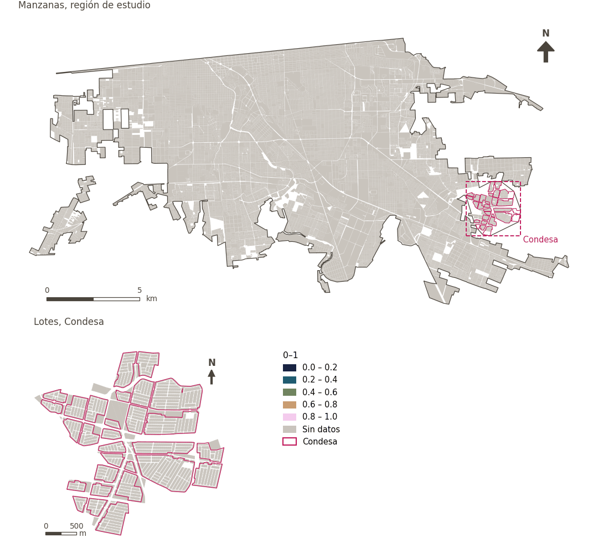

# Diversidad de empleos

[← Volver al contenido](../README.md)

> Diversidad (0-1) de los sectores económicos en torno a las áreas residenciales.

## Identificación

| | |
|---|---|
| Identificador | `job_diversity` |
| Medida central (hoja de variables) | Acceso al empleo |
| ID de la hoja / registro | – |
| Variable en puntos de muestra | `sp_ext_economic_sector_diversity` |
| Variable de área (valor medido) | `ext_economic_sector_diversity` (0–1) |
| Puntuación normalizada | `index_uli__job_diversity` |
| Dominios (parte del peso) | [Desarrollo económico](domain_economic_development.md) |
| Subdominio | Economía |
| Enfoque | Diversidad |
| Mejor si es | mayor |
| Peso efectivo en el índice | `uli` 5.0% · `uli_plain` 5.0% |
| Estado | Se puntúa en el índice publicado |

## Justificación e interpretación

*Pendiente: No consta en el registro del proyecto.*

**Cómo leerlo.** Diversidad media de sectores económicos de … (0-1).

**Job diversity** (Access to employment; ID –) (en inglés en la hoja)
- *Cómo calcular (hoja de variables):* Diversity of economic sectors within a XX buffer of residential areas.
- *Dudas (hoja):* Ask Natalia about this one

## Fuentes de datos

**Fuentes declaradas en la configuración:**

- Mexicali ULI work packages (final_indicators.gpkg, 22 September 2026).

**Fuente registrada por GHSCI (diccionario de datos)** (`ext_economic_sector_diversity`):

- Work package indicators: Mexicali ULI work packages (final_indicators.gpkg; see excel_work_sheet_key.xlsx)

**Insumos:** [Indicadores de los paquetes de trabajo (vinculados)](work_package_layers.md)

## Método: teoría

1. Valor preparado fuera de GHSCI por un paquete de trabajo y vinculado a las áreas de referencia (R7: por geometría contra las áreas de referencia).
2. Replicado a cada punto de muestra desde el área que lo contiene (`grid`, `condesa_lotes (15 m)`, `manzanas (30 m)`).
3. Normalización AMPI (R11) del valor tal cual, agregación (R12) y áreas (R13).

## Método: práctica

**Recetas:** [R1. Puntos de muestra y red peatonal](../03_recipes.md#r1), [R7. Vinculación de indicadores preparados externamente](../03_recipes.md#r7), [R11. Normalización: el Índice Ajustado de Mazziotta–Pareto (AMPI)](../03_recipes.md#r11), [R12. Agregación: dominios, indicadores compartidos e índice](../03_recipes.md#r12), [R13. De los puntos de muestra a las áreas](../03_recipes.md#r13), [R14. Metas congeladas y recálculo de un escenario](../03_recipes.md#r14)

**Configuración** ([`MX_Mexicali_2025_ULI.yml:1656`](../../data/MX_Mexicali_2025_ULI.yml#L1656)):

```yaml
- variable: sp_ext_economic_sector_diversity
  name: job_diversity
  domains: [economic_development]
  polarity: positive
  lens: diversity
  group: {es: 'Acceso al empleo', en: 'Access to employment'}
  label: {es: 'Diversidad de empleos', en: 'Job diversity'}
  reading: {es: 'Diversidad media de sectores económicos de {value} (0-1)', en: 'Mean diversity of economic sectors of {value} (0-1)'}
  subdomain: {es: 'Economía', en: 'Economy'}
  about:
    es: Diversidad (0-1) de los sectores económicos en torno a las áreas residenciales.
    en: Diversity (0-1) of economic sectors around residential areas.
  sources:
    - 'Mexicali ULI work packages (final_indicators.gpkg, 22 September 2026).'
```

**Código (GHSCI):**

- [`process/subprocesses/_linkage_indicators.py:403`](https://github.com/healthysustainablecities/global-indicators/blob/f03909611dba336c2728fffab6d697779487d0b1/process/subprocesses/_linkage_indicators.py#L403) `match_by_geometry()`
- [`process/subprocesses/_linkage_indicators.py:537`](https://github.com/healthysustainablecities/global-indicators/blob/f03909611dba336c2728fffab6d697779487d0b1/process/subprocesses/_linkage_indicators.py#L537) `sample_point_values()`
- [`process/subprocesses/_composite_index.py:1819`](https://github.com/healthysustainablecities/global-indicators/blob/f03909611dba336c2728fffab6d697779487d0b1/process/subprocesses/_composite_index.py#L1819) `normalise()`
- [`process/subprocesses/_composite_index.py:1838`](https://github.com/healthysustainablecities/global-indicators/blob/f03909611dba336c2728fffab6d697779487d0b1/process/subprocesses/_composite_index.py#L1838) `mpi_aggregate()`

|  | Variable en puntos de muestra | Transformación | Metas (escala puntuada) | inf – sup | asim. / curt. / empates | Alertas |
|---|---|---|---|---|---|---|
| `uli` | sp_ext_economic_sector_diversity | tal cual | −0.236 · 0.264 · 0.764 | 0.000 – 1.000 | 1.00 / −0.96 / 71.9% | ninguna |
| `uli_plain` | sp_ext_economic_sector_diversity | tal cual | −0.236 · 0.264 · 0.764 | 0.000 – 1.000 | 1.00 / −0.96 / 71.9% | ninguna |

## Recálculo (Reimagina Urbano)

El valor viene de un paquete de trabajo externo: un escenario (p. ej., más vegetación) sustituye el valor del área y se replica a sus puntos de muestra.

Con las metas congeladas del archivo de parámetros (`Ref`, `Mín.`, `Máx.`, R14), una nueva puntuación es `r = 100 ± 60·(x − Ref)/(Máx. − Mín.)` sin volver a resolver metas; el dominio y el índice se recalculan con R12 y se resta 100. Así un escenario se compara con la línea base en la misma escala.

## Resultados

| Medida | Región de estudio (Mexicali con Condesa) | Condesa |
|---|---|---|
| Valor de la región | 0.33 | – |
| Puntuación de la región (`uli`) | +3.7 | −14.1 |
| Áreas con valor | 0 de 14,252 manzanas | – |
| Mediana (P25–P75), ponderada | – | – |
| Rango | – | – |
| Puntuación: mediana (P25–P75) (`uli`) | +2.1 (−13.4 – +15.1) | −15.8 (−15.8 – −15.8) |

*Distribuciones: manzanas de la región de estudio ponderadas por su población censal (2020); lotes de Condesa con igual peso (3.2 residentes supuestos por lote). Los valores de la región son los que GHSCI reporta para cada región en conjunto.*

- Región de estudio: Diversidad media de sectores económicos de 0.33 (0-1).
- Condesa: Diversidad media de sectores económicos de – (0-1).
- Para la región de estudio en su conjunto, el valor es 0.33; en Condesa, –. La puntuación de Condesa queda 14.1 puntos por debajo del promedio de la región de estudio (+3.7 para la región de estudio).

## Mapa



*Mapa. Diversidad de empleos: valor medido (0–1) por manzana en la región de estudio y por lote en Condesa (recuadro). Clases del tablero; los colores favorables son los claros (mayor es mejor).*

## Advertencias y pendientes

- Entregado solo para la cuadrícula de 100 m, que cubre la ciudad, de modo que cada punto de muestra toma el valor de su celda (configuración). La distancia de la hoja no está especificada («XX»).
