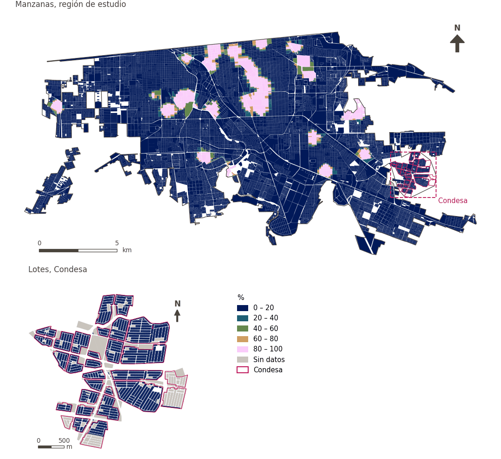

# Gran espacio verde público a menos de 500 m

[← Volver al contenido](../README.md)

> Acceso a pie, a 500 m, a un espacio verde público grande.

## Identificación

| | |
|---|---|
| Identificador | `lpugs` |
| Medida central (hoja de variables) | Accesibilidad a grandes espacios públicos abiertos |
| ID de la hoja / registro | 91, 187 · #91, #187 |
| Variable en puntos de muestra | `sp_access_large_public_green_space_score` |
| Variable de área (valor medido) | `pct_access_500m_large_public_green_space_score` (%) |
| Puntuación normalizada | `index_uli__lpugs` |
| Dominios (parte del peso) | [Entorno medioambiental](domain_ambient_environment.md) (50%), [Ambiente construido](domain_built_environment.md) (50%) |
| Subdominio | Entorno medioambiental: Medioambiente; Ambiente construido: Infraestructura verde y azul |
| Enfoque | Accesibilidad |
| Mejor si es | mayor |
| Peso efectivo en el índice | `uli` 4.0% · `uli_plain` 3.8% |
| Estado | Se puntúa en el índice publicado |

## Justificación e interpretación

> El artículo fuente no estuvo disponible para su revisión. (traducción preliminar del inglés)
>
> — *Registro de indicadores #91: Access to public green space (Built Environment / Green & Blue Infrastructure)*

- Cita del libro de trabajo: Not reported.

> La disponibilidad de espacios abiertos ofrece a los residentes urbanos lugares de confort, disfrute y descanso, lo que contribuye directamente a su calidad de vida. (traducción preliminar del inglés)
>
> — *Registro de indicadores #187: Access to public open space (Built Environment / Green & Blue Infrastructure)*

- Cita del libro de trabajo: Zhan et al., 2018, 'Assessment and Determinants of Satisfaction with Urban Livability in China'; Paul & Sen, 2018, 'Livability Assessment within a Metropolis Based on the Impact of Integrated Urban Geographic Factors (IUGFs) on Clustering Urban Centers of Kolkata'
- Lista de artículos: #18: Jodder (2024), ‘Urban Livability in a Rapidly Urbanizing Mid-Size City: Lessons for Planning in the Global South’
- ⚠ la cita del libro de trabajo no nombra a un autor del artículo de la lista; verifique antes de citar (citation_audit.csv)

**Cómo leerlo.** … de la población vive a menos de 500 m de un gran espacio verde público (mayor es mejor).

**% of total land area within 500 m pedestrian network distance of LPUGS (LPUGS Accesibility)** (Large Public Open Spaces Accesibility; ID 91, 187) (en inglés en la hoja)
- *Cómo calcular (hoja de variables):* USE GHSCI CALCULATION HERE
- *Notas (hoja):* Exclude inaccessible/private land.
- *Dudas (hoja):* Do we want to include plazas here?

**% of population with access to LPUGS within 500 m pedestrian network distance (LPUGS Accesibility)** (Large Public Open Spaces Accesibility; ID 91, 187) (en inglés en la hoja)
- *Cómo calcular (hoja de variables):* USE GHSCI CALCULATION HERE
- *Notas (hoja):* Exclude inaccessible/private land.
- *Dudas (hoja):* Do we want to include plazas here?

## Fuentes de datos

**Fuentes declaradas en la configuración:**

- GHSCI large public urban green space indicator (Google Earth Engine), with OpenStreetMap public open space.

**Fuente registrada por GHSCI (diccionario de datos)** (`pct_access_500m_large_public_green_space_score`):

- OpenStreetMap: Geofabrik GmbH, 20260815, ODbL, https://download.geofabrik.de/north-america/mexico-latest.osm.pbf, OpenStreetMap Contributors.  Geofabrik GmbH (2026). https://download.geofabrik.de/north-america/mexico-latest.osm.pbf

**Insumos:** [Espacio público abierto y grandes espacios verdes públicos](public_open_space.md)

## Método: teoría

1. Grandes espacios verdes públicos: espacios públicos abiertos de OpenStreetMap de al menos 1 ha con NDVI medio anual ≥ 0.2 (Sentinel-2), identificados en Google Earth Engine (R8).
2. Distancia por la red peatonal a su entrada más cercana (R2) y acceso binario a 500 m (R3).
3. En áreas, el porcentaje de puntos con acceso. Normalización AMPI (R11), agregación (R12) y áreas (R13).

## Método: práctica

**Recetas:** [R1. Puntos de muestra y red peatonal](../03_recipes.md#r1), [R8. Earth Engine: vulnerabilidad al calor y grandes espacios verdes](../03_recipes.md#r8), [R2. Distancia por la red al destino más cercano, censurada](../03_recipes.md#r2), [R3. Acceso por bandas y lejanía de una desamenidad](../03_recipes.md#r3), [R11. Normalización: el Índice Ajustado de Mazziotta–Pareto (AMPI)](../03_recipes.md#r11), [R12. Agregación: dominios, indicadores compartidos e índice](../03_recipes.md#r12), [R13. De los puntos de muestra a las áreas](../03_recipes.md#r13), [R14. Metas congeladas y recálculo de un escenario](../03_recipes.md#r14)

**Configuración** ([`MX_Mexicali_2025_ULI.yml:1330`](../../data/MX_Mexicali_2025_ULI.yml#L1330)):

```yaml
- variable: sp_access_large_public_green_space_score
  name: lpugs
  domains: [ambient_environment, built_environment]
  lens: accessibility
  group: {es: 'Accesibilidad a grandes espacios públicos abiertos', en: 'Large public open space accessibility'}
  label: {es: 'Gran espacio verde público a menos de 500 m', en: 'Large public green space within 500 m'}
  reading: {es: '{value} de la población vive a menos de 500 m de un gran espacio verde público', en: '{value} of the population live within 500 m of a large public green space'}
  subdomain:
    ambient_environment: {es: 'Medioambiente', en: 'Ambient'}
    built_environment: {es: 'Infraestructura verde y azul', en: 'Green and blue infrastructure'}
  about:
    es: Acceso a pie, a 500 m, a un espacio verde público grande.
    en: Walking access within 500 m to a large public green space.
  sources:
    - 'GHSCI large public urban green space indicator (Google Earth Engine), with OpenStreetMap public open space.'
```

**Código (GHSCI):**

- [`process/subprocesses/_earth_engine_indicators.py:282`](https://github.com/healthysustainablecities/global-indicators/blob/f03909611dba336c2728fffab6d697779487d0b1/process/subprocesses/_earth_engine_indicators.py#L282) `lpugs_analysis()`
- [`process/subprocesses/_earth_engine_indicators.py:664`](https://github.com/healthysustainablecities/global-indicators/blob/f03909611dba336c2728fffab6d697779487d0b1/process/subprocesses/_earth_engine_indicators.py#L664) `lpugs_indicators()`
- [`process/subprocesses/_composite_index.py:1819`](https://github.com/healthysustainablecities/global-indicators/blob/f03909611dba336c2728fffab6d697779487d0b1/process/subprocesses/_composite_index.py#L1819) `normalise()`
- [`process/subprocesses/_composite_index.py:1838`](https://github.com/healthysustainablecities/global-indicators/blob/f03909611dba336c2728fffab6d697779487d0b1/process/subprocesses/_composite_index.py#L1838) `mpi_aggregate()`

|  | Variable en puntos de muestra | Transformación | Metas (escala puntuada) | inf – sup | asim. / curt. / empates | Alertas |
|---|---|---|---|---|---|---|
| `uli` | sp_access_large_public_green_space_score | tal cual | −0.419 · 0.081 · 0.581 | 0.000 – 1.000 | 3.08 / 7.51 / 92.0% | skewed, tied |
| `uli_plain` | sp_access_large_public_green_space_score | tal cual | −0.419 · 0.081 · 0.581 | 0.000 – 1.000 | 3.08 / 7.51 / 92.0% | skewed, tied |

## Recálculo (Reimagina Urbano)

Un destino nuevo o retirado, o un cambio en la red peatonal, cambia `d` solo en los puntos cuyo destino más cercano cambia: basta un Dijkstra multi-origen desde los destinos afectados, limitado a 1,500 m, tomando el mínimo con la distancia previa.

Con las metas congeladas del archivo de parámetros (`Ref`, `Mín.`, `Máx.`, R14), una nueva puntuación es `r = 100 ± 60·(x − Ref)/(Máx. − Mín.)` sin volver a resolver metas; el dominio y el índice se recalculan con R12 y se resta 100. Así un escenario se compara con la línea base en la misma escala.

## Resultados

| Medida | Región de estudio (Mexicali con Condesa) | Condesa |
|---|---|---|
| Valor de la región | 8.2% | 0.0% |
| Puntuación de la región (`uli`) | +0.1 | −4.8 |
| Áreas con valor | 14,216 de 14,252 manzanas | 13,265 de 14,988 lotes |
| Mediana (P25–P75), ponderada | 0.0% (0.0% – 0.0%) | 0.0% (0.0% – 0.0%) |
| Rango | 0.0% – 100.0% | 0.0% – 0.0% |
| Puntuación: mediana (P25–P75) (`uli`) | −4.8 (−4.8 – −4.8) | −4.8 (−4.8 – −4.8) |

*Distribuciones: manzanas de la región de estudio ponderadas por su población censal (2020); lotes de Condesa con igual peso (3.2 residentes supuestos por lote). Los valores de la región son los que GHSCI reporta para cada región en conjunto.*

- Región de estudio: 8.2% de la población vive a menos de 500 m de un gran espacio verde público.
- Condesa: 0.0% de la población vive a menos de 500 m de un gran espacio verde público.
- Para la región de estudio en su conjunto, el valor es 8.2%; en Condesa, 0.0%. La puntuación de Condesa queda 4.8 puntos por debajo del promedio de la región de estudio (+0.1 para la región de estudio).

## Mapa



*Mapa. Gran espacio verde público a menos de 500 m: valor medido (%) por manzana en la región de estudio y por lote en Condesa (recuadro). Clases del tablero; los colores favorables son los claros (mayor es mejor).*

## Advertencias y pendientes

- Esta es la subvariable de accesibilidad, que calcula el flujo central de GHSCI. La subvariable aparte de disponibilidad de la hoja (la parte del suelo de un área que es gran espacio verde público) describe un área y no el entorno de un punto de muestra, por lo que no se puntúa en el índice por ahora (configuración). La hoja pregunta si deben incluirse las plazas.
