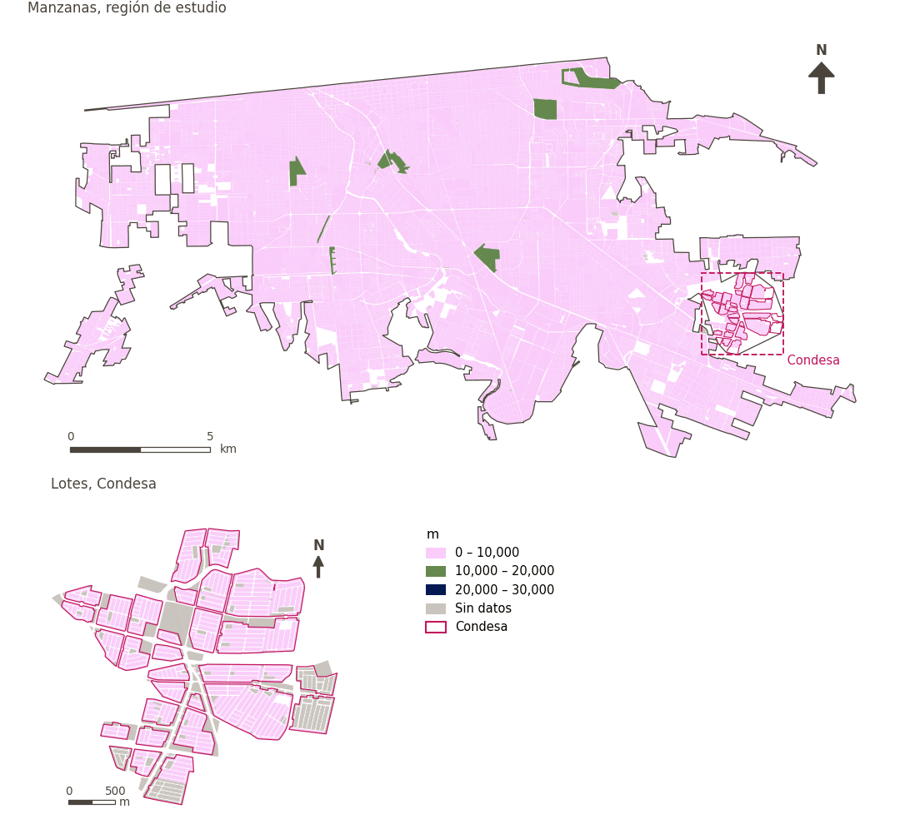

# Proximidad a vialidades principales

[← Volver al contenido](../README.md)

> Longitud de vialidades principales a 300 m, una aproximación a la exposición al ruido, la contaminación y el riesgo del tráfico; menor es mejor.

## Identificación

| | |
|---|---|
| Identificador | `major_roads` |
| Medida central (hoja de variables) | Proximidad a altos niveles de tráfico |
| ID de la hoja / registro | 125 · #125 |
| Variable en puntos de muestra | `sp_ext_major_road_length_300m` |
| Variable de área (valor medido) | `ext_major_road_length_300m` (m) |
| Puntuación normalizada | `index_uli__major_roads` |
| Dominios (parte del peso) | [Entorno medioambiental](domain_ambient_environment.md) (50%), [Seguridad y protección](domain_safety.md) (50%) |
| Subdominio | Entorno medioambiental: Medioambiente; Seguridad y protección: Seguridad vial |
| Enfoque | Proximidad |
| Mejor si es | menor |
| Peso efectivo en el índice | `uli` 5.9% · `uli_plain` 5.7% |
| Estado | Se puntúa en el índice publicado |

## Justificación e interpretación

> Las vialidades principales son fuente de contaminación del aire y ruido, asociadas con efectos negativos en la salud. (traducción preliminar del inglés)
>
> — *Registro de indicadores #125: Access to major road (Built Environment / Urban Morphology)*

- Cita del libro de trabajo: Zhan et al., 2018, 'Assessment and Determinants of Satisfaction with Urban Livability in China'; Tao et al., 2015, 'Housing Choices of Migrant Workers in China: Beyond the Hukou Perspective'
- Lista de artículos: #18: Jodder (2024), ‘Urban Livability in a Rapidly Urbanizing Mid-Size City: Lessons for Planning in the Global South’
- ⚠ la cita del libro de trabajo no nombra a un autor del artículo de la lista; verifique antes de citar (citation_audit.csv)

**Cómo leerlo.** En promedio, … de vialidades principales a 300 m (menor es mejor).

**Proximity to major roads** (Proximity to high levels of traffic; ID 125) (en inglés en la hoja)
- *Cómo calcular (hoja de variables):* Length of major roads within a 500m radius of each block/ageb

## Fuentes de datos

**Fuentes declaradas en la configuración:**

- Mexicali ULI work packages (final_indicators.gpkg, 22 September 2026).

**Fuente registrada por GHSCI (diccionario de datos)** (`ext_major_road_length_300m`):

- Work package indicators: Mexicali ULI work packages (final_indicators.gpkg; see excel_work_sheet_key.xlsx)

**Insumos:** [Indicadores de los paquetes de trabajo (vinculados)](work_package_layers.md)

## Método: teoría

1. Valor preparado fuera de GHSCI por un paquete de trabajo y vinculado a las áreas de referencia (R7: por geometría contra las áreas de referencia).
2. Replicado a cada punto de muestra desde el área que lo contiene (`grid`, `condesa_lotes (15 m)`, `manzanas (30 m)`).
3. Normalización AMPI (R11) del valor tal cual, agregación (R12) y áreas (R13).

## Método: práctica

**Recetas:** [R1. Puntos de muestra y red peatonal](../03_recipes.md#r1), [R7. Vinculación de indicadores preparados externamente](../03_recipes.md#r7), [R11. Normalización: el Índice Ajustado de Mazziotta–Pareto (AMPI)](../03_recipes.md#r11), [R12. Agregación: dominios, indicadores compartidos e índice](../03_recipes.md#r12), [R13. De los puntos de muestra a las áreas](../03_recipes.md#r13), [R14. Metas congeladas y recálculo de un escenario](../03_recipes.md#r14)

**Configuración** ([`MX_Mexicali_2025_ULI.yml:1346`](../../data/MX_Mexicali_2025_ULI.yml#L1346)):

```yaml
- variable: sp_ext_major_road_length_300m
  name: major_roads
  domains: [ambient_environment, safety]
  polarity: negative
  lens: proximity
  group: {es: 'Proximidad a altos niveles de tráfico', en: 'Proximity to high levels of traffic'}
  label: {es: 'Proximidad a vialidades principales', en: 'Proximity to major roads'}
  reading: {es: 'En promedio, {value} de vialidades principales a 300 m', en: 'On average, {value} of major roads within 300 m'}
  subdomain:
    ambient_environment: {es: 'Medioambiente', en: 'Ambient'}
    safety: {es: 'Seguridad vial', en: 'Road safety'}
  about:
    es: Longitud de vialidades principales a 300 m, una aproximación a la exposición al ruido, la contaminación y el riesgo del tráfico; menor es mejor.
    en: Length of major roads within 300 m, a proxy for exposure to traffic noise, pollution and danger; lower is better.
  sources:
    - 'Mexicali ULI work packages (final_indicators.gpkg, 22 September 2026).'
```

**Código (GHSCI):**

- [`process/subprocesses/_linkage_indicators.py:403`](https://github.com/healthysustainablecities/global-indicators/blob/f03909611dba336c2728fffab6d697779487d0b1/process/subprocesses/_linkage_indicators.py#L403) `match_by_geometry()`
- [`process/subprocesses/_linkage_indicators.py:537`](https://github.com/healthysustainablecities/global-indicators/blob/f03909611dba336c2728fffab6d697779487d0b1/process/subprocesses/_linkage_indicators.py#L537) `sample_point_values()`
- [`process/subprocesses/_composite_index.py:1819`](https://github.com/healthysustainablecities/global-indicators/blob/f03909611dba336c2728fffab6d697779487d0b1/process/subprocesses/_composite_index.py#L1819) `normalise()`
- [`process/subprocesses/_composite_index.py:1838`](https://github.com/healthysustainablecities/global-indicators/blob/f03909611dba336c2728fffab6d697779487d0b1/process/subprocesses/_composite_index.py#L1838) `mpi_aggregate()`

|  | Variable en puntos de muestra | Transformación | Metas (escala puntuada) | inf – sup | asim. / curt. / empates | Alertas |
|---|---|---|---|---|---|---|
| `uli` | sp_ext_major_road_length_300m | tal cual | −2,429 · 1,756 · 5,940 | 0 – 8,368 | 0.62 / 0.16 / 20.7% | ninguna |
| `uli_plain` | sp_ext_major_road_length_300m | tal cual | −2,429 · 1,756 · 5,940 | 0 – 8,368 | 0.62 / 0.16 / 20.7% | ninguna |

## Recálculo (Reimagina Urbano)

El valor viene de un paquete de trabajo externo: un escenario (p. ej., más vegetación) sustituye el valor del área y se replica a sus puntos de muestra.

Con las metas congeladas del archivo de parámetros (`Ref`, `Mín.`, `Máx.`, R14), una nueva puntuación es `r = 100 ± 60·(x − Ref)/(Máx. − Mín.)` sin volver a resolver metas; el dominio y el índice se recalculan con R12 y se resta 100. Así un escenario se compara con la línea base en la misma escala.

## Resultados

| Medida | Región de estudio (Mexicali con Condesa) | Condesa |
|---|---|---|
| Valor de la región | 1,996 m | 414 m |
| Puntuación de la región (`uli`) | −1.7 | +8.5 |
| Áreas con valor | 14,200 de 14,252 manzanas | 13,265 de 14,988 lotes |
| Mediana (P25–P75), ponderada | 1,848 m (1,075 m – 2,890 m) | 0 m (0 m – 949 m) |
| Rango | 0 m – 16,859 m | 0 m – 2,115 m |
| Puntuación: mediana (P25–P75) (`uli`) | +0.4 (−6.5 – +5.5) | +12.6 (+3.0 – +12.6) |

*Distribuciones: manzanas de la región de estudio ponderadas por su población censal (2020); lotes de Condesa con igual peso (3.2 residentes supuestos por lote). Los valores de la región son los que GHSCI reporta para cada región en conjunto.*

- Región de estudio: En promedio, 1,996 m de vialidades principales a 300 m.
- Condesa: En promedio, 414 m de vialidades principales a 300 m.
- Para la región de estudio en su conjunto, el valor es 1,996 m; en Condesa, 414 m. La puntuación de Condesa queda 8.5 puntos por encima del promedio de la región de estudio (−1.7 para la región de estudio).

## Mapa



*Mapa. Proximidad a vialidades principales: valor medido (m) por manzana en la región de estudio y por lote en Condesa (recuadro). Clases del tablero; los colores favorables son los claros (menor es mejor).*

## Advertencias y pendientes

- La hoja describe la longitud de vialidades principales a 500 m; la variable entregada es a 300 m (final_indicators.gpkg).
