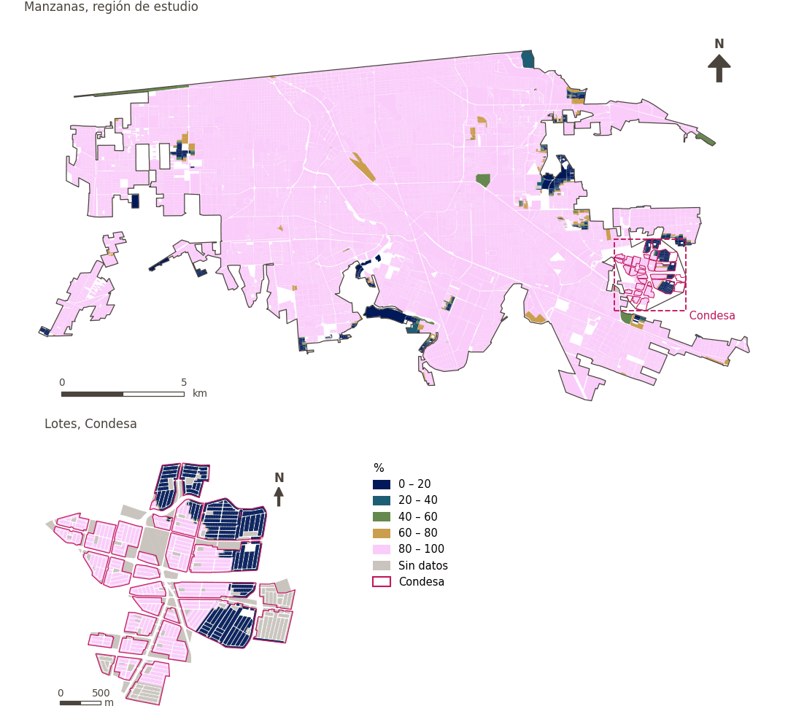

# Manufactura a menos de 1 km

[← Volver al contenido](../README.md)

> Si hay un establecimiento manufacturero a 1 km a pie, como aproximación al acceso al empleo.

## Identificación

| | |
|---|---|
| Identificador | `manufacturing_1000m` |
| Medida central (hoja de variables) | Acceso al empleo |
| ID de la hoja / registro | 127 · #127 |
| Variable en puntos de muestra | `sp_walk_access_denue_manufacturing_1000m` |
| Variable de área (valor medido) | `pct_access_walk_denue_manufacturing_1000m` (%) |
| Puntuación normalizada | `index_uli__manufacturing_1000m` |
| Dominios (parte del peso) | [Desarrollo económico](domain_economic_development.md) |
| Subdominio | Economía |
| Enfoque | Accesibilidad |
| Mejor si es | mayor |
| Peso efectivo en el índice | `uli` 5.0% · `uli_plain` 5.0% |
| Estado | Se puntúa en el índice publicado |

## Justificación e interpretación

> Los centros manufactureros son fuente de riesgos industriales y contaminación; restringir la cercanía residencial asegura la seguridad física y protege el bienestar. (traducción preliminar del inglés)
>
> — *Registro de indicadores #127: Access to manufacturing district / centre (Economic Development / Economy)*

- Cita del libro de trabajo: Onnom et al., 2018, 'Development of a Liveable City Index (LCI) using multi criteria geospatial modelling for medium class cities in developing countries'
- Lista de artículos: #20: Basu (2021), ‘Urban livability index assessment based on land-use changes in an Indian medium-sized city (Raiganj)’
- ⚠ la cita del libro de trabajo no nombra a un autor del artículo de la lista; verifique antes de citar (citation_audit.csv)

**Cómo leerlo.** … de la población vive a menos de 1 km a pie de un establecimiento manufacturero (mayor es mejor).

**Access to manufacturing district/centre** (Access to employment; ID 127) (en inglés en la hoja)
- *Cómo calcular (hoja de variables):* Destination analysis using GHSCI tools with permutations of: distance to closest, access within threshold(s), and where applicable count per sqkm and per 1,000 persons
- *Dudas (hoja):* Should this one be split into separate sub-variables?

## Fuentes de datos

**Fuentes declaradas en la configuración:**

- INEGI (2026) Directorio Estadístico Nacional de Unidades Económicas (DENUE), May 2026.

**Fuente registrada por GHSCI (diccionario de datos)** (`pct_access_walk_denue_manufacturing_1000m`):

- OpenStreetMap: Geofabrik GmbH, 20260815, ODbL, https://download.geofabrik.de/north-america/mexico-latest.osm.pbf, OpenStreetMap Contributors.  Geofabrik GmbH (2026). https://download.geofabrik.de/north-america/mexico-latest.osm.pbf; INEGI, Directorio Estadistico Nacional de Unidades Economicas (DENUE): 2026-05, Terminos de Libre Uso de la Informacion del INEGI, https://www.inegi.org.mx/app/mapa/denue/, INEGI (2026). Directorio Estadistico Nacional de Unidades Economicas (DENUE), mayo 2026. Instituto Nacional de Estadistica y Geografia, Mexico.

**Filtro de destinos:**

- `denue_manufacturing` (Manufacturing and industrial establishments (DENUE)): `MX/INEGI/DENUE_2026/denue_inegi_02_.shp` — Filtro de destinos: `"codigo_act LIKE '31%' OR codigo_act LIKE '32%' OR codigo_act LIKE '33%'"`

**Insumos:** [Destinos del DENUE por código SCIAN](denue_destinations.md)

## Método: teoría

1. Distancia por la red peatonal al destino más cercano, `d` (R2).
2. Acceso binario (R3): `a = 1` si `d ≤ 1,000 m`, si no `a = 0` (incluye nada encontrado). Se usa el acceso binario porque la búsqueda a 1,500 m no se extiende lo bastante más allá de 1,000 m para un umbral suave.
3. En áreas, el porcentaje de puntos con acceso. Normalización AMPI (R11), agregación (R12) y áreas (R13).

## Método: práctica

**Recetas:** [R1. Puntos de muestra y red peatonal](../03_recipes.md#r1), [R2. Distancia por la red al destino más cercano, censurada](../03_recipes.md#r2), [R3. Acceso por bandas y lejanía de una desamenidad](../03_recipes.md#r3), [R11. Normalización: el Índice Ajustado de Mazziotta–Pareto (AMPI)](../03_recipes.md#r11), [R12. Agregación: dominios, indicadores compartidos e índice](../03_recipes.md#r12), [R13. De los puntos de muestra a las áreas](../03_recipes.md#r13), [R14. Metas congeladas y recálculo de un escenario](../03_recipes.md#r14)

**Configuración** ([`MX_Mexicali_2025_ULI.yml:1642`](../../data/MX_Mexicali_2025_ULI.yml#L1642)):

```yaml
- variable: sp_walk_access_denue_manufacturing_1000m
  name: manufacturing_1000m
  domains: [economic_development]
  group: {es: 'Acceso al empleo', en: 'Access to employment'}
  label: {es: 'Manufactura a menos de 1 km', en: 'Manufacturing within 1 km'}
  reading: {es: '{value} de la población vive a menos de 1 km a pie de un establecimiento manufacturero', en: '{value} of the population live within a 1 km walk of a manufacturing establishment'}
  subdomain: {es: 'Economía', en: 'Economy'}
  about:
    es: Si hay un establecimiento manufacturero a 1 km a pie, como aproximación al acceso al empleo.
    en: Whether a manufacturing establishment lies within a 1 km walk, as a proxy for access to employment.
  sources:
    - 'INEGI (2026) Directorio Estadístico Nacional de Unidades Económicas (DENUE), May 2026.'
```

[`MX_Mexicali_2025_ULI.yml:524`](../../data/MX_Mexicali_2025_ULI.yml#L524):

```yaml
- {name: denue_manufacturing, category: manufacturing, variant: any, layer: destinations, where: "dest_name = 'denue_manufacturing'"}
```

**Código (GHSCI):**

- [`process/subprocesses/_accessibility_spec.py:806`](https://github.com/healthysustainablecities/global-indicators/blob/f03909611dba336c2728fffab6d697779487d0b1/process/subprocesses/_accessibility_spec.py#L806) `_banded_distances()`
- [`process/subprocesses/setup_sp.py:888`](https://github.com/healthysustainablecities/global-indicators/blob/f03909611dba336c2728fffab6d697779487d0b1/process/subprocesses/setup_sp.py#L888) `create_full_nodes()`
- [`process/subprocesses/_accessibility_spec.py:1272`](https://github.com/healthysustainablecities/global-indicators/blob/f03909611dba336c2728fffab6d697779487d0b1/process/subprocesses/_accessibility_spec.py#L1272) `sample_point_access()`
- [`process/subprocesses/_composite_index.py:1819`](https://github.com/healthysustainablecities/global-indicators/blob/f03909611dba336c2728fffab6d697779487d0b1/process/subprocesses/_composite_index.py#L1819) `normalise()`
- [`process/subprocesses/_composite_index.py:1838`](https://github.com/healthysustainablecities/global-indicators/blob/f03909611dba336c2728fffab6d697779487d0b1/process/subprocesses/_composite_index.py#L1838) `mpi_aggregate()`

|  | Variable en puntos de muestra | Transformación | Metas (escala puntuada) | inf – sup | asim. / curt. / empates | Alertas |
|---|---|---|---|---|---|---|
| `uli` | sp_walk_access_denue_manufacturing_1000m | tal cual | 0.435 · 0.935 · 1.435 | 0.000 – 1.000 | −3.51 / 10.34 / 93.5% | skewed, tied |
| `uli_plain` | sp_walk_access_denue_manufacturing_1000m | tal cual | 0.435 · 0.935 · 1.435 | 0.000 – 1.000 | −3.51 / 10.34 / 93.5% | skewed, tied |

## Recálculo (Reimagina Urbano)

Un destino nuevo o retirado, o un cambio en la red peatonal, cambia `d` solo en los puntos cuyo destino más cercano cambia: basta un Dijkstra multi-origen desde los destinos afectados, limitado a 1,500 m, tomando el mínimo con la distancia previa.

Con las metas congeladas del archivo de parámetros (`Ref`, `Mín.`, `Máx.`, R14), una nueva puntuación es `r = 100 ± 60·(x − Ref)/(Máx. − Mín.)` sin volver a resolver metas; el dominio y el índice se recalculan con R12 y se resta 100. Así un escenario se compara con la línea base en la misma escala.

## Resultados

| Medida | Región de estudio (Mexicali con Condesa) | Condesa |
|---|---|---|
| Valor de la región | 99.4% | 62.6% |
| Puntuación de la región (`uli`) | +3.6 | −18.5 |
| Áreas con valor | 14,216 de 14,252 manzanas | 13,265 de 14,988 lotes |
| Mediana (P25–P75), ponderada | 100.0% (100.0% – 100.0%) | 100.0% (0.0% – 100.0%) |
| Rango | 0.0% – 100.0% | 0.0% – 100.0% |
| Puntuación: mediana (P25–P75) (`uli`) | +3.9 (+3.9 – +3.9) | +3.9 (−56.1 – +3.9) |

*Distribuciones: manzanas de la región de estudio ponderadas por su población censal (2020); lotes de Condesa con igual peso (3.2 residentes supuestos por lote). Los valores de la región son los que GHSCI reporta para cada región en conjunto.*

- Región de estudio: 99.4% de la población vive a menos de 1 km a pie de un establecimiento manufacturero.
- Condesa: 62.6% de la población vive a menos de 1 km a pie de un establecimiento manufacturero.
- Para la región de estudio en su conjunto, el valor es 99.4%; en Condesa, 62.6%. La puntuación de Condesa queda 18.5 puntos por debajo del promedio de la región de estudio (+3.6 para la región de estudio).

## Mapa



*Mapa. Manufactura a menos de 1 km: valor medido (%) por manzana en la región de estudio y por lote en Condesa (recuadro). Clases del tablero; los colores favorables son los claros (mayor es mejor).*

## Advertencias y pendientes

- La manufactura se interpreta aquí como fuente de empleo: la hoja sitúa esta subvariable en la medida central «Acceso al empleo», de modo que tenerla al alcance cuenta como mejor. La justificación del registro para esta fila proviene de una fuente que trata los centros manufactureros como riesgos industriales; esa lectura se registra arriba por completitud, pero no es la que aplica el índice.
