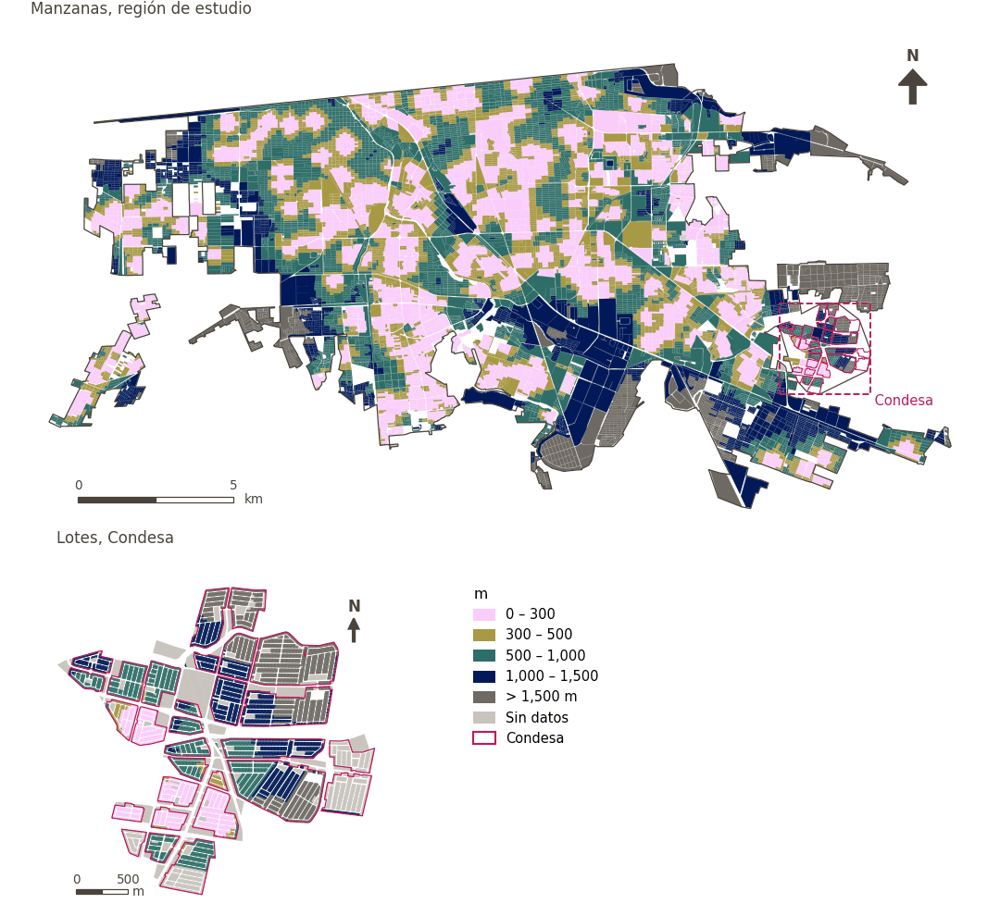

# Parques a menos de 300 m

[← Volver al contenido](../README.md)

> Distancia a pie al espacio público abierto más cercano, puntuada con un umbral suave de 300 m.

## Identificación

| | |
|---|---|
| Identificador | `parks` |
| Medida central (hoja de variables) | Acceso a parques |
| ID de la hoja / registro | 162 · #162, #187 |
| Variable en puntos de muestra | `sp_walk_nearest_node_public_open_space_any` |
| Variable de área (valor medido) | `avg_walk_dist_public_open_space_any` (m) |
| Puntuación normalizada | `index_uli__parks` |
| Dominios (parte del peso) | [Entorno medioambiental](domain_ambient_environment.md) (50%), [Ambiente construido](domain_built_environment.md) (50%) |
| Subdominio | Entorno medioambiental: Medioambiente; Ambiente construido: Infraestructura verde y azul |
| Enfoque | Proximidad |
| Mejor si es | valor medido menor (puntuación transformada mayor) |
| Peso efectivo en el índice | `uli` 4.0% · `uli_plain` 3.8% |
| Estado | Se puntúa en el índice publicado |

## Justificación e interpretación

> El artículo fuente no estuvo disponible para su revisión. (traducción preliminar del inglés)
>
> — *Registro de indicadores #162: Access to parks (local, neighbourhood, district, regional) (Built Environment / Green & Blue Infrastructure)*

- Cita del libro de trabajo: Not reported.
- Lista de artículos: #19: Wu (2022), ‘Urban greenness, mixed land-use, and life satisfaction: Evidence from residential locations and workplace settings in Beijing’
- ⚠ la cita del libro de trabajo no nombra a un autor del artículo de la lista; verifique antes de citar (citation_audit.csv)

> La disponibilidad de espacios abiertos ofrece a los residentes urbanos lugares de confort, disfrute y descanso, lo que contribuye directamente a su calidad de vida. (traducción preliminar del inglés)
>
> — *Registro de indicadores #187: Access to public open space (Built Environment / Green & Blue Infrastructure)*

- Cita del libro de trabajo: Zhan et al., 2018, 'Assessment and Determinants of Satisfaction with Urban Livability in China'; Paul & Sen, 2018, 'Livability Assessment within a Metropolis Based on the Impact of Integrated Urban Geographic Factors (IUGFs) on Clustering Urban Centers of Kolkata'
- Lista de artículos: #18: Jodder (2024), ‘Urban Livability in a Rapidly Urbanizing Mid-Size City: Lessons for Planning in the Global South’
- ⚠ la cita del libro de trabajo no nombra a un autor del artículo de la lista; verifique antes de citar (citation_audit.csv)

**Cómo leerlo.** … de la población vive a menos de 300 m de un parque o espacio público abierto; en promedio, el más cercano está a … (menor es mejor).

**Access to parks (local, neighbourhood, district, regional)** (Access to parks; ID 162) (en inglés en la hoja)
- *Cómo calcular (hoja de variables):* USE GHSCI CALCULATION HERE

**Population with access to parks** (Access to parks; ID 162) (en inglés en la hoja)
- *Cómo calcular (hoja de variables):* USE GHSCI CALCULATION HERE

## Fuentes de datos

**Fuentes declaradas en la configuración:**

- OpenStreetMap contributors (Geofabrik Mexico extract, 15 August 2026); public open space identified by GHSCI.

**Fuente registrada por GHSCI (diccionario de datos)** (`avg_walk_dist_public_open_space_any`):

- OpenStreetMap: Geofabrik GmbH, 20260815, ODbL, https://download.geofabrik.de/north-america/mexico-latest.osm.pbf, OpenStreetMap Contributors.  Geofabrik GmbH (2026). https://download.geofabrik.de/north-america/mexico-latest.osm.pbf

**Insumos:** [Espacio público abierto y grandes espacios verdes públicos](public_open_space.md)

## Método: teoría

1. Distancia por la red peatonal desde cada punto de muestra al destino más cercano, `d` (R2), censurada en la banda mayor buscada (1,500 m): un punto sin destino a esa distancia queda sin valor.
2. Puntuación de acceso suave (R10): `s(d) = 1 / (1 + exp(k·(d − t)/t))`, con `t = 300 m` y `k = 5`; `s = 0.5` en el umbral, ≈ 0.99 junto al destino, ≈ 0.007 a `2t`; sin valor → `s = 0`.
3. Normalización AMPI (R11) de `s` con las metas de la región de estudio, luego agregación por dominio e índice (R12) y a áreas (R13).

## Método: práctica

**Recetas:** [R1. Puntos de muestra y red peatonal](../03_recipes.md#r1), [R2. Distancia por la red al destino más cercano, censurada](../03_recipes.md#r2), [R10. Transformaciones: umbrales suaves y escalas escalonadas](../03_recipes.md#r10), [R11. Normalización: el Índice Ajustado de Mazziotta–Pareto (AMPI)](../03_recipes.md#r11), [R12. Agregación: dominios, indicadores compartidos e índice](../03_recipes.md#r12), [R13. De los puntos de muestra a las áreas](../03_recipes.md#r13), [R14. Metas congeladas y recálculo de un escenario](../03_recipes.md#r14)

**Configuración** ([`MX_Mexicali_2025_ULI.yml:1315`](../../data/MX_Mexicali_2025_ULI.yml#L1315)):

```yaml
- variable: sp_walk_nearest_node_public_open_space_any
  name: parks
  domains: [ambient_environment, built_environment]
  transform: {soft_threshold: 300}
  group: {es: 'Acceso a parques', en: 'Access to parks'}
  label: {es: 'Parques a menos de 300 m', en: 'Parks within 300 m'}
  reading: {es: '{access} de la población vive a menos de 300 m de un parque o espacio público abierto; en promedio, el más cercano está a {value}', en: '{access} of the population live within 300 m of a park or public open space; on average the nearest is {value} away'}
  subdomain:
    ambient_environment: {es: 'Medioambiente', en: 'Ambient'}
    built_environment: {es: 'Infraestructura verde y azul', en: 'Green and blue infrastructure'}
  about:
    es: Distancia a pie al espacio público abierto más cercano, puntuada con un umbral suave de 300 m.
    en: Walking distance to the nearest public open space, scored with a 300 m soft threshold.
  sources:
    - 'OpenStreetMap contributors (Geofabrik Mexico extract, 15 August 2026); public open space identified by GHSCI.'
```

[`MX_Mexicali_2025_ULI.yml:475`](../../data/MX_Mexicali_2025_ULI.yml#L475):

```yaml
- {name: public_open_space_any,   category: pos,  variant: lenient, layer: aos_public_any_nodes_30m_line}
```

**Código (GHSCI):**

- [`process/subprocesses/_accessibility_spec.py:806`](https://github.com/healthysustainablecities/global-indicators/blob/f03909611dba336c2728fffab6d697779487d0b1/process/subprocesses/_accessibility_spec.py#L806) `_banded_distances()`
- [`process/subprocesses/setup_sp.py:888`](https://github.com/healthysustainablecities/global-indicators/blob/f03909611dba336c2728fffab6d697779487d0b1/process/subprocesses/setup_sp.py#L888) `create_full_nodes()`
- [`process/subprocesses/_composite_index.py:1457`](https://github.com/healthysustainablecities/global-indicators/blob/f03909611dba336c2728fffab6d697779487d0b1/process/subprocesses/_composite_index.py#L1457) `soft_threshold()`
- [`process/subprocesses/_composite_index.py:1819`](https://github.com/healthysustainablecities/global-indicators/blob/f03909611dba336c2728fffab6d697779487d0b1/process/subprocesses/_composite_index.py#L1819) `normalise()`
- [`process/subprocesses/_composite_index.py:1838`](https://github.com/healthysustainablecities/global-indicators/blob/f03909611dba336c2728fffab6d697779487d0b1/process/subprocesses/_composite_index.py#L1838) `mpi_aggregate()`

|  | Variable en puntos de muestra | Transformación | Metas (escala puntuada) | inf – sup | asim. / curt. / empates | Alertas |
|---|---|---|---|---|---|---|
| `uli` | sp_walk_nearest_node_public_open_space_any | acceso suave, umbral de 300 m, k = 5 | −0.197 · 0.299 · 0.796 | 0.000 – 0.993 | 0.80 / −1.10 / 12.9% | ninguna |
| `uli_plain` | sp_walk_nearest_node_public_open_space_any | acceso suave, umbral de 300 m, k = 5 | −0.197 · 0.299 · 0.796 | 0.000 – 0.993 | 0.80 / −1.10 / 12.9% | ninguna |

## Recálculo (Reimagina Urbano)

Un destino nuevo o retirado, o un cambio en la red peatonal, cambia `d` solo en los puntos cuyo destino más cercano cambia: basta un Dijkstra multi-origen desde los destinos afectados, limitado a 1,500 m, tomando el mínimo con la distancia previa.

Con las metas congeladas del archivo de parámetros (`Ref`, `Mín.`, `Máx.`, R14), una nueva puntuación es `r = 100 ± 60·(x − Ref)/(Máx. − Mín.)` sin volver a resolver metas; el dominio y el índice se recalculan con R12 y se resta 100. Así un escenario se compara con la línea base en la misma escala.

## Resultados

| Medida | Región de estudio (Mexicali con Condesa) | Condesa |
|---|---|---|
| Valor de la región | 469 m | 849 m |
| Puntuación de la región (`uli`) | +3.7 | −9.9 |
| Áreas con valor | 13,268 de 14,252 manzanas | 9,054 de 14,988 lotes |
| Mediana (P25–P75), ponderada | 357 m (205 m – 637 m) | 811 m (469 m – 1,309 m) |
| Rango | 5 m – 2,271 m | 11 m – 2,609 m |
| Nada a la distancia buscada | 5.0% | 31.7% |
| Puntuación: mediana (P25–P75) (`uli`) | −1.0 (−17.9 – +27.4) | −18.1 (−18.1 – −18.0) |

*Distribuciones: manzanas de la región de estudio ponderadas por su población censal (2020); lotes de Condesa con igual peso (3.2 residentes supuestos por lote). Los valores de la región son los que GHSCI reporta para cada región en conjunto.*

*Una distancia media se calcula sobre los puntos que encontraron un destino dentro de la distancia buscada; la fila «Nada a la distancia buscada» da la parte de la población de las áreas sin ninguno.*

- Región de estudio: 36.9% de la población vive a menos de 300 m de un parque o espacio público abierto; en promedio, el más cercano está a 469 m.
- Condesa: 14.8% de la población vive a menos de 300 m de un parque o espacio público abierto; en promedio, el más cercano está a 849 m.
- Para la región de estudio en su conjunto, el valor es 469 m; en Condesa, 849 m. La puntuación de Condesa queda 9.9 puntos por debajo del promedio de la región de estudio (+3.7 para la región de estudio).

## Mapa



*Mapa. Parques a menos de 300 m: valor medido (m) por manzana en la región de estudio y por lote en Condesa (recuadro). Clases del tablero; los colores favorables son los claros (menor es mejor).*

## Advertencias y pendientes

- Donde la hoja empareja el acceso con el porcentaje de población con acceso, un solo indicador sirve para ambos: en un punto de muestra son la misma medida (configuración).
