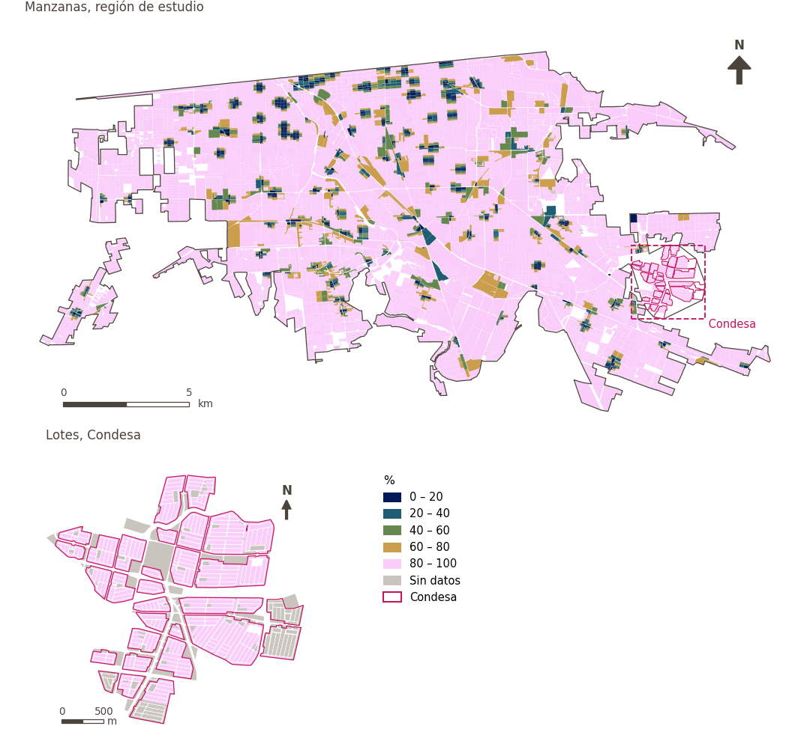

# A 250 m o más de gasolineras

[← Volver al contenido](../README.md)

> Si la gasolinera más cercana está a 250 m o más a pie (una desventaja cuando está más cerca).

## Identificación

| | |
|---|---|
| Identificador | `petrol_250m` |
| Medida central (hoja de variables) | Acceso a servicios esenciales cotidianos |
| ID de la hoja / registro | 169 · #169 |
| Variable en puntos de muestra | `sp_walk_beyond_denue_petrol_station_250m` |
| Variable de área (valor medido) | `pct_beyond_walk_denue_petrol_station_250m` (%) |
| Puntuación normalizada | `index_uli__petrol_250m` |
| Dominios (parte del peso) | [Infraestructura social](domain_social_infrastructure.md) (33%), [Movilidad y transporte](domain_mobility_transport.md) (33%), [Desarrollo económico](domain_economic_development.md) (33%) |
| Subdominio | Infraestructura social: Servicios públicos; Desarrollo económico: Recursos |
| Enfoque | Proximidad |
| Mejor si es | mayor |
| Peso efectivo en el índice | `uli` 3.6% · `uli_plain` 3.6% |
| Estado | Se puntúa en el índice publicado |

## Justificación e interpretación

> Vivir a una distancia suficiente de las gasolineras mejora la seguridad de los residentes al reducir los riesgos de incendios y accidentes asociados con sitios de combustibles peligrosos. (traducción preliminar del inglés)
>
> — *Registro de indicadores #169: Access to petrol station (>= 250m away) (Economic Development / Resources)*

- Cita del libro de trabajo: Basu et al., 2021, 'Urban Livability Index Assessment Based on Land-Use Changes in an Indian Medium-Sized City (Raiganj)'
- Lista de artículos: #18: Jodder (2024), ‘Urban Livability in a Rapidly Urbanizing Mid-Size City: Lessons for Planning in the Global South’
- ⚠ la cita del libro de trabajo no nombra a un autor del artículo de la lista; verifique antes de citar (citation_audit.csv)

**Cómo leerlo.** … de la población vive a 250 m o más de una gasolinera (mayor es mejor).

**Access to petrol station (>= 250m away)** (Daily essential-services access; ID 169) (en inglés en la hoja)
- *Cómo calcular (hoja de variables):* Average distance access to petrol stations
- *Notas (hoja):* CH: the evidence for this one might be complex -- I can imagine there might be a sweet spot --- yes, you don't want to be too close (how close is that, maybe that is our indicator --- not within XXX distance m, if we can link with citable evidence.) But the reality is people do drive, and need petrol or perhaps electrical charging; living too far from one could impact some aspects of life. Lets be guided by evidence here. Here's a good basis for an indicator: Petrol station within 250m is associated with increased relative risk of childhood leukemia. Another study: https://link.springer.com/article/10.1007/s00420-021-01767-y
- *Dudas (hoja):* I am not sure these are relevant, I added them considering that most people use cars in Mexicali for their daily commute

**Percentage of population with access to petrol stations** (Daily essential-services access; ID 169) (en inglés en la hoja)
- *Cómo calcular (hoja de variables):* USE GHSCI CALCULATION HERE (Average distance (m) along the pedestrian network to the nearest 'denue petrol station' (custom destination) (population weighted))
- *Dudas (hoja):* I am not sure these are relevant, I added them considering that most people use cars in Mexicali for their daily commute

## Fuentes de datos

**Fuentes declaradas en la configuración:**

- INEGI (2026) Directorio Estadístico Nacional de Unidades Económicas (DENUE), May 2026.

**Fuente registrada por GHSCI (diccionario de datos)** (`pct_beyond_walk_denue_petrol_station_250m`):

- OpenStreetMap: Geofabrik GmbH, 20260815, ODbL, https://download.geofabrik.de/north-america/mexico-latest.osm.pbf, OpenStreetMap Contributors.  Geofabrik GmbH (2026). https://download.geofabrik.de/north-america/mexico-latest.osm.pbf; INEGI, Directorio Estadistico Nacional de Unidades Economicas (DENUE): 2026-05, Terminos de Libre Uso de la Informacion del INEGI, https://www.inegi.org.mx/app/mapa/denue/, INEGI (2026). Directorio Estadistico Nacional de Unidades Economicas (DENUE), mayo 2026. Instituto Nacional de Estadistica y Geografia, Mexico.

**Filtro de destinos:**

- `denue_petrol_station` (Petrol stations (DENUE)): `MX/INEGI/DENUE_2026/denue_inegi_02_.shp` — Filtro de destinos: `"codigo_act IN ('468411','468413')"`

**Insumos:** [Destinos del DENUE por código SCIAN](denue_destinations.md)

## Método: teoría

1. Distancia por la red peatonal a la gasolinera más cercana, `d` (R2).
2. Indicador binario de lejanía (R3, `direction: avoid`): `b = 1` si `d > 250 m` o no hay gasolinera en la distancia buscada; `b = 0` si está a 250 m o menos.
3. En áreas, el porcentaje de puntos con `b = 1`. Normalización AMPI (R11), agregación (R12) y áreas (R13).

## Método: práctica

**Recetas:** [R1. Puntos de muestra y red peatonal](../03_recipes.md#r1), [R2. Distancia por la red al destino más cercano, censurada](../03_recipes.md#r2), [R3. Acceso por bandas y lejanía de una desamenidad](../03_recipes.md#r3), [R11. Normalización: el Índice Ajustado de Mazziotta–Pareto (AMPI)](../03_recipes.md#r11), [R12. Agregación: dominios, indicadores compartidos e índice](../03_recipes.md#r12), [R13. De los puntos de muestra a las áreas](../03_recipes.md#r13), [R14. Metas congeladas y recálculo de un escenario](../03_recipes.md#r14)

**Configuración** ([`MX_Mexicali_2025_ULI.yml:1523`](../../data/MX_Mexicali_2025_ULI.yml#L1523)):

```yaml
- variable: sp_walk_beyond_denue_petrol_station_250m
  name: petrol_250m
  domains: [social_infrastructure, mobility_transport, economic_development]
  lens: proximity
  group: {es: 'Acceso a servicios esenciales cotidianos', en: 'Daily essential-services access'}
  label: {es: 'A 250 m o más de gasolineras', en: '250 m or more from petrol stations'}
  reading: {es: '{value} de la población vive a 250 m o más de una gasolinera', en: '{value} of the population live 250 m or more from a petrol station'}
  subdomain:
    social_infrastructure: {es: 'Servicios públicos', en: 'Public services'}
    economic_development: {es: 'Recursos', en: 'Resources'}
  about:
    es: Si la gasolinera más cercana está a 250 m o más a pie (una desventaja cuando está más cerca).
    en: Whether the nearest petrol station is 250 m or more away on foot (a disamenity when closer).
  sources:
    - 'INEGI (2026) Directorio Estadístico Nacional de Unidades Económicas (DENUE), May 2026.'
```

[`MX_Mexicali_2025_ULI.yml:533`](../../data/MX_Mexicali_2025_ULI.yml#L533):

```yaml
- {name: denue_petrol_station, category: petrol_station, variant: any, layer: destinations, where: "dest_name = 'denue_petrol_station'", distances: [250], direction: avoid}
```

**Código (GHSCI):**

- [`process/subprocesses/_accessibility_spec.py:806`](https://github.com/healthysustainablecities/global-indicators/blob/f03909611dba336c2728fffab6d697779487d0b1/process/subprocesses/_accessibility_spec.py#L806) `_banded_distances()`
- [`process/subprocesses/setup_sp.py:888`](https://github.com/healthysustainablecities/global-indicators/blob/f03909611dba336c2728fffab6d697779487d0b1/process/subprocesses/setup_sp.py#L888) `create_full_nodes()`
- [`process/subprocesses/_accessibility_spec.py:1272`](https://github.com/healthysustainablecities/global-indicators/blob/f03909611dba336c2728fffab6d697779487d0b1/process/subprocesses/_accessibility_spec.py#L1272) `sample_point_access()`
- [`process/subprocesses/_composite_index.py:1819`](https://github.com/healthysustainablecities/global-indicators/blob/f03909611dba336c2728fffab6d697779487d0b1/process/subprocesses/_composite_index.py#L1819) `normalise()`
- [`process/subprocesses/_composite_index.py:1838`](https://github.com/healthysustainablecities/global-indicators/blob/f03909611dba336c2728fffab6d697779487d0b1/process/subprocesses/_composite_index.py#L1838) `mpi_aggregate()`

|  | Variable en puntos de muestra | Transformación | Metas (escala puntuada) | inf – sup | asim. / curt. / empates | Alertas |
|---|---|---|---|---|---|---|
| `uli` | sp_walk_beyond_denue_petrol_station_250m | tal cual | 0.421 · 0.921 · 1.421 | 0.000 – 1.000 | −3.13 / 7.77 / 92.1% | skewed, tied |
| `uli_plain` | sp_walk_beyond_denue_petrol_station_250m | tal cual | 0.421 · 0.921 · 1.421 | 0.000 – 1.000 | −3.13 / 7.77 / 92.1% | skewed, tied |

## Recálculo (Reimagina Urbano)

Un destino nuevo o retirado, o un cambio en la red peatonal, cambia `d` solo en los puntos cuyo destino más cercano cambia: basta un Dijkstra multi-origen desde los destinos afectados, limitado a 1,500 m, tomando el mínimo con la distancia previa.

Con las metas congeladas del archivo de parámetros (`Ref`, `Mín.`, `Máx.`, R14), una nueva puntuación es `r = 100 ± 60·(x − Ref)/(Máx. − Mín.)` sin volver a resolver metas; el dominio y el índice se recalculan con R12 y se resta 100. Así un escenario se compara con la línea base en la misma escala.

## Resultados

| Medida | Región de estudio (Mexicali con Condesa) | Condesa |
|---|---|---|
| Valor de la región | 92.2% | 100.0% |
| Puntuación de la región (`uli`) | 0.0 | +4.7 |
| Áreas con valor | 14,216 de 14,252 manzanas | 13,265 de 14,988 lotes |
| Mediana (P25–P75), ponderada | 100.0% (100.0% – 100.0%) | 100.0% (100.0% – 100.0%) |
| Rango | 0.0% – 100.0% | 100.0% – 100.0% |
| Puntuación: mediana (P25–P75) (`uli`) | +4.7 (+4.7 – +4.7) | +4.7 (+4.7 – +4.7) |

*Distribuciones: manzanas de la región de estudio ponderadas por su población censal (2020); lotes de Condesa con igual peso (3.2 residentes supuestos por lote). Los valores de la región son los que GHSCI reporta para cada región en conjunto.*

- Región de estudio: 92.2% de la población vive a 250 m o más de una gasolinera.
- Condesa: 100.0% de la población vive a 250 m o más de una gasolinera.
- Para la región de estudio en su conjunto, el valor es 92.2%; en Condesa, 100.0%. La puntuación de Condesa queda 4.7 puntos por encima del promedio de la región de estudio (0.0 para la región de estudio).

## Mapa



*Mapa. A 250 m o más de gasolineras: valor medido (%) por manzana en la región de estudio y por lote en Condesa (recuadro). Clases del tablero; los colores favorables son los claros (mayor es mejor).*

## Advertencias y pendientes

- Las notas de la hoja citan un mayor riesgo relativo de leucemia infantil a menos de 250 m de una gasolinera, y registran dudas sobre su pertinencia, pues la mayoría en Mexicali se desplaza en automóvil.
