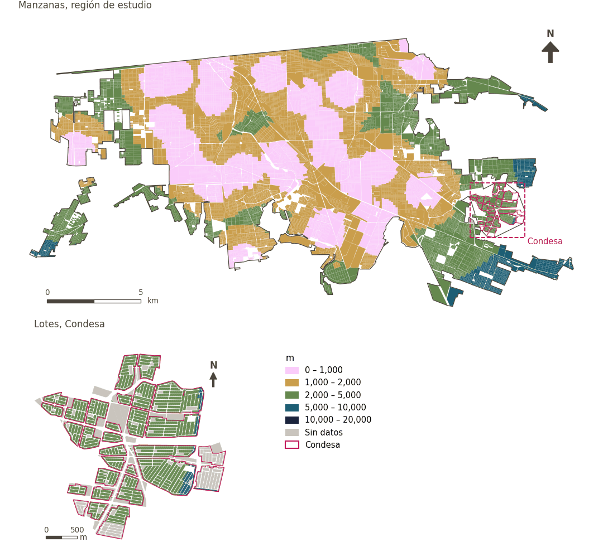

# Estación de policía a menos de 2 km

[← Volver al contenido](../README.md)

> Distancia en línea recta a la instalación policial más cercana, puntuada con un umbral suave de 2 km.

## Identificación

| | |
|---|---|
| Identificador | `police_2km` |
| Medida central (hoja de variables) | Seguridad personal y vial |
| ID de la hoja / registro | 69, 174 · #174 |
| Variable en puntos de muestra | `sp_euclid_dist_imip_police_station` |
| Variable de área (valor medido) | `avg_euclid_dist_imip_police_station` (m) |
| Puntuación normalizada | `index_uli__police_2km` |
| Dominios (parte del peso) | [Seguridad y protección](domain_safety.md) (33%), [Movilidad y transporte](domain_mobility_transport.md) (33%), [Ambiente construido](domain_built_environment.md) (33%) |
| Subdominio | Seguridad y protección: Seguridad personal |
| Enfoque | Proximidad |
| Mejor si es | valor medido menor (puntuación transformada mayor) |
| Peso efectivo en el índice | `uli` 6.2% · `uli_plain` 6.2% |
| Estado | Se puntúa en el índice publicado |

## Justificación e interpretación

> Los barrios ubicados cerca de estaciones de policía experimentan mayor seguridad y estabilidad, lo que permite a los residentes vivir sin sentirse amenazados o en peligro. (traducción preliminar del inglés)
>
> — *Registro de indicadores #174: Access to police station (Safety / Personal Safety)*

- Cita del libro de trabajo: Fu et al., 2019, 'The Livable Urban Landscape: GIS and Remote Sensing Extracted Land Use Assessment for Urban Livability in Changchun Proper, China'; Liu et al., 2020, 'Using Multi-Source Data to Assess Livability in Hong Kong at the Community-Based Level: A Combined Subjective-Objective Approach'; Paul & Sen, 2018, 'Livability Assessment within a Metropolis Based on the Impact of Integrated Urban Geographic Factors (IUGFs) on Clustering Urban Centers of Kolkata'
- Lista de artículos: #18: Jodder (2024), ‘Urban Livability in a Rapidly Urbanizing Mid-Size City: Lessons for Planning in the Global South’; #20: Basu (2021), ‘Urban livability index assessment based on land-use changes in an Indian medium-sized city (Raiganj)’; #8: Onnom (2018), ‘Development of a Liveable City Index (LCI) Using Multi Criteria Geospatial Modelling for Medium Class Cities in Developing Countries’
- ⚠ la cita del libro de trabajo no nombra a un autor del artículo de la lista; verifique antes de citar (citation_audit.csv)

**Cómo leerlo.** En promedio, la estación de policía más cercana está a … en línea recta (menor es mejor).

**% of the population with coverage of police stations** (Personal and road safety; ID 69, 174) (en inglés en la hoja)
- *Cómo calcular (hoja de variables):* % of the population that is within a network buffer of 15 km around a police station
- *Notas (hoja):* Threshold change from 15km to 2km (road network unavailable; 15km covered 100% of municipality with no variation). Euclidean distance. ~64% of grid cells within 2 km. Condesa: 40/40.
- *Dudas (hoja):* For this one we need to define a redius that covers multiple neighborhoods (review SEDESOL)

## Fuentes de datos

**Fuentes declaradas en la configuración:**

- IMIP equipamiento layer via CFC (27 police facilities); threshold revised by the work package (Alejandro).

**Fuente registrada por GHSCI (diccionario de datos)** (`avg_euclid_dist_imip_police_station`):

- Police stations (IMIP): IMIP / CFC, Provided by IMIP via CFC

**Insumos:** [Estaciones de policía y bomberos (línea recta)](emergency_stations.md)

## Método: teoría

1. Distancia en línea recta desde cada punto de muestra a la estación más cercana, `d` (R5), buscada hasta 45 km; más allá, sin valor.
2. Acceso suave (R10): `s(d) = 1 / (1 + exp(k·(d − t)/t))`, `t = 2,000 m`, `k = 5`; sin valor → 0.
3. Normalización AMPI (R11), agregación (R12) y áreas (R13).

## Método: práctica

**Recetas:** [R1. Puntos de muestra y red peatonal](../03_recipes.md#r1), [R5. Áreas de servicio en línea recta](../03_recipes.md#r5), [R10. Transformaciones: umbrales suaves y escalas escalonadas](../03_recipes.md#r10), [R11. Normalización: el Índice Ajustado de Mazziotta–Pareto (AMPI)](../03_recipes.md#r11), [R12. Agregación: dominios, indicadores compartidos e índice](../03_recipes.md#r12), [R13. De los puntos de muestra a las áreas](../03_recipes.md#r13), [R14. Metas congeladas y recálculo de un escenario](../03_recipes.md#r14)

**Configuración** ([`MX_Mexicali_2025_ULI.yml:1409`](../../data/MX_Mexicali_2025_ULI.yml#L1409)):

```yaml
- variable: sp_euclid_dist_imip_police_station
  name: police_2km
  domains: [safety, mobility_transport, built_environment]
  transform: {soft_threshold: 2000}
  group: {es: 'Seguridad personal y vial', en: 'Personal and road safety'}
  label: {es: 'Estación de policía a menos de 2 km', en: 'Police station within 2 km'}
  reading: {es: 'En promedio, la estación de policía más cercana está a {value} en línea recta', en: 'On average the nearest police station is {value} away in a straight line'}
  subdomain:
    safety: {es: 'Seguridad personal', en: 'Personal safety'}
  about:
    es: Distancia en línea recta a la instalación policial más cercana, puntuada con un umbral suave de 2 km.
    en: Straight-line distance to the nearest police facility, scored with a 2 km soft threshold.
  sources:
    - 'IMIP equipamiento layer via CFC (27 police facilities); threshold revised by the work package (Alejandro).'
```

**Código (GHSCI):**

- [`process/subprocesses/_euclidean_accessibility.py:247`](https://github.com/healthysustainablecities/global-indicators/blob/f03909611dba336c2728fffab6d697779487d0b1/process/subprocesses/_euclidean_accessibility.py#L247) `nearest_distances()`
- [`process/subprocesses/_composite_index.py:1457`](https://github.com/healthysustainablecities/global-indicators/blob/f03909611dba336c2728fffab6d697779487d0b1/process/subprocesses/_composite_index.py#L1457) `soft_threshold()`
- [`process/subprocesses/_composite_index.py:1819`](https://github.com/healthysustainablecities/global-indicators/blob/f03909611dba336c2728fffab6d697779487d0b1/process/subprocesses/_composite_index.py#L1819) `normalise()`
- [`process/subprocesses/_composite_index.py:1838`](https://github.com/healthysustainablecities/global-indicators/blob/f03909611dba336c2728fffab6d697779487d0b1/process/subprocesses/_composite_index.py#L1838) `mpi_aggregate()`

|  | Variable en puntos de muestra | Transformación | Metas (escala puntuada) | inf – sup | asim. / curt. / empates | Alertas |
|---|---|---|---|---|---|---|
| `uli` | sp_euclid_dist_imip_police_station | acceso suave, umbral de 2,000 m, k = 5 | 0.115 · 0.611 · 1.108 | 0.000 – 0.993 | −0.63 / −1.26 / 0.1% | ninguna |
| `uli_plain` | sp_euclid_dist_imip_police_station | acceso suave, umbral de 2,000 m, k = 5 | 0.115 · 0.611 · 1.108 | 0.000 – 0.993 | −0.63 / −1.26 / 0.1% | ninguna |

## Recálculo (Reimagina Urbano)

Una estación nueva cambia `d` en los puntos más cercanos a ella que a cualquier otra: `d = min(d_previa, distancia euclidiana a la nueva estación)`.

Con las metas congeladas del archivo de parámetros (`Ref`, `Mín.`, `Máx.`, R14), una nueva puntuación es `r = 100 ± 60·(x − Ref)/(Máx. − Mín.)` sin volver a resolver metas; el dominio y el índice se recalculan con R12 y se resta 100. Así un escenario se compara con la línea base en la misma escala.

## Resultados

| Medida | Región de estudio (Mexicali con Condesa) | Condesa |
|---|---|---|
| Valor de la región | 1,406 m | 4,156 m |
| Puntuación de la región (`uli`) | +7.9 | −36.1 |
| Áreas con valor | 14,216 de 14,252 manzanas | 13,265 de 14,988 lotes |
| Mediana (P25–P75), ponderada | 1,284 m (763 m – 2,014 m) | 4,220 m (3,813 m – 4,593 m) |
| Rango | 53 m – 8,906 m | 2,537 m – 5,548 m |
| Puntuación: mediana (P25–P75) (`uli`) | +14.8 (−7.3 – +20.8) | −36.7 (−36.8 – −36.3) |

*Distribuciones: manzanas de la región de estudio ponderadas por su población censal (2020); lotes de Condesa con igual peso (3.2 residentes supuestos por lote). Los valores de la región son los que GHSCI reporta para cada región en conjunto.*

- Región de estudio: En promedio, la estación de policía más cercana está a 1,406 m en línea recta.
- Condesa: En promedio, la estación de policía más cercana está a 4,156 m en línea recta.
- Para la región de estudio en su conjunto, el valor es 1,406 m; en Condesa, 4,156 m. La puntuación de Condesa queda 36.1 puntos por debajo del promedio de la región de estudio (+7.9 para la región de estudio).

## Mapa



*Mapa. Estación de policía a menos de 2 km: valor medido (m) por manzana en la región de estudio y por lote en Condesa (recuadro). Clases del tablero; los colores favorables son los claros (menor es mejor).*

## Advertencias y pendientes

- El umbral se revisó de 15 km a 2 km por el paquete de trabajo: 15 km cubrían todo el municipio sin variación. Distancia en línea recta, pues la red vial no estaba disponible para el paquete de trabajo (nota de la hoja).
