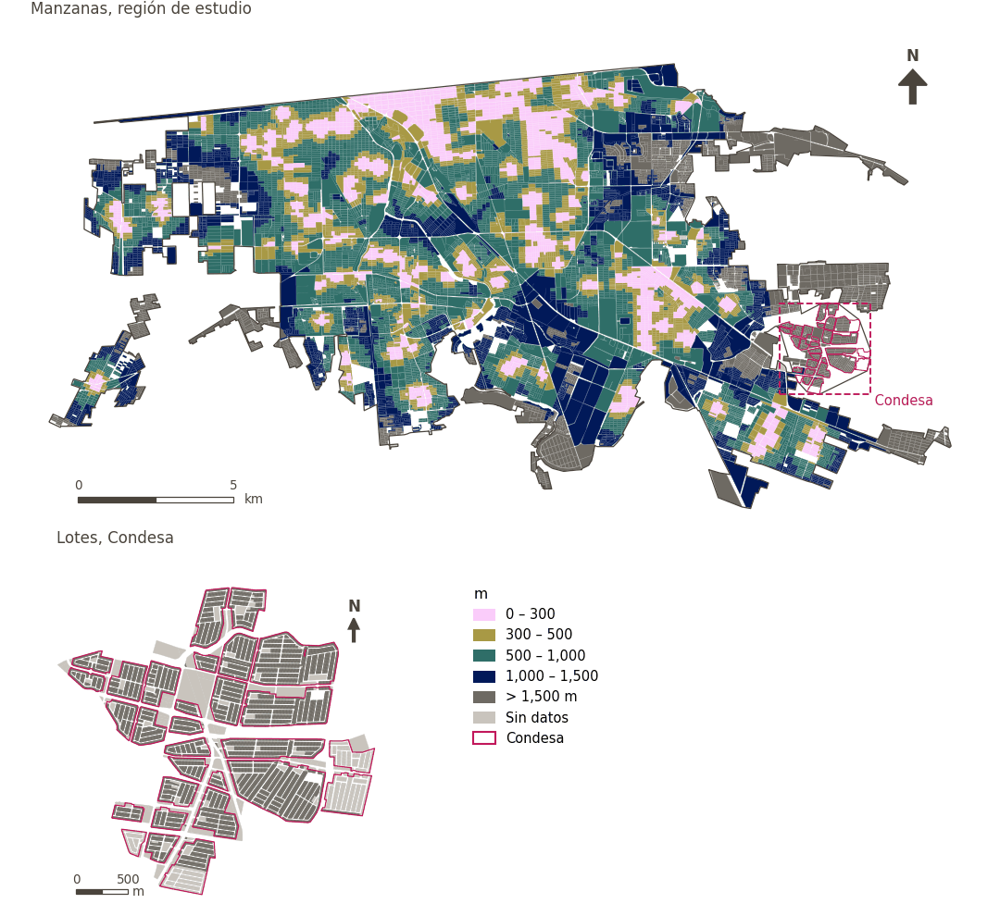

# Atención primaria de salud a menos de 300 m

[← Volver al contenido](../README.md)

> Distancia a pie al servicio de atención primaria más cercano, puntuada con un umbral suave de 300 m.

## Identificación

| | |
|---|---|
| Identificador | `primary_healthcare` |
| Medida central (hoja de variables) | Acceso a salud, educación y cuidados |
| ID de la hoja / registro | 97, 101, 170 · #97 |
| Variable en puntos de muestra | `sp_walk_nearest_node_denue_primary_healthcare` |
| Variable de área (valor medido) | `avg_walk_dist_denue_primary_healthcare` (m) |
| Puntuación normalizada | `index_uli__primary_healthcare` |
| Dominios (parte del peso) | [Infraestructura social](domain_social_infrastructure.md) |
| Subdominio | Salud y atención sanitaria |
| Enfoque | Proximidad |
| Mejor si es | valor medido menor (puntuación transformada mayor) |
| Peso efectivo en el índice | `uli` 1.7% · `uli_plain` 1.7% |
| Estado | Se puntúa en el índice publicado |

## Justificación e interpretación

> La cercanía a instalaciones de salud es esencial para la calidad de vida urbana y asegura que los residentes tengan acceso oportuno a servicios médicos. (traducción preliminar del inglés)
>
> — *Registro de indicadores #97: Access to health centres (Social Infrastructure / Health & Healthcare)*

- Cita del libro de trabajo: McMichael, 2000, 'The urban environment and health in a world of increasing globalisation: issues for developing countries'
- Lista de artículos: #19: Wu (2022), ‘Urban greenness, mixed land-use, and life satisfaction: Evidence from residential locations and workplace settings in Beijing’; #20: Basu (2021), ‘Urban livability index assessment based on land-use changes in an Indian medium-sized city (Raiganj)’
- ⚠ la cita del libro de trabajo no nombra a un autor del artículo de la lista; verifique antes de citar (citation_audit.csv)

**Cómo leerlo.** … de la población vive a menos de 300 m de un servicio de atención primaria; en promedio, el más cercano está a … (menor es mejor).

**Access to health & health care services** (Health, education and care access; ID 97,101, 170) (en inglés en la hoja)
- *Cómo calcular (hoja de variables):* Walking distance access to health centers, clinics, hospitals and pharmacies.

## Fuentes de datos

**Fuentes declaradas en la configuración:**

- INEGI (2026) Directorio Estadístico Nacional de Unidades Económicas (DENUE), May 2026.

**Fuente registrada por GHSCI (diccionario de datos)** (`avg_walk_dist_denue_primary_healthcare`):

- OpenStreetMap: Geofabrik GmbH, 20260815, ODbL, https://download.geofabrik.de/north-america/mexico-latest.osm.pbf, OpenStreetMap Contributors.  Geofabrik GmbH (2026). https://download.geofabrik.de/north-america/mexico-latest.osm.pbf; INEGI, Directorio Estadistico Nacional de Unidades Economicas (DENUE): 2026-05, Terminos de Libre Uso de la Informacion del INEGI, https://www.inegi.org.mx/app/mapa/denue/, INEGI (2026). Directorio Estadistico Nacional de Unidades Economicas (DENUE), mayo 2026. Instituto Nacional de Estadistica y Geografia, Mexico.

**Filtro de destinos:**

- `denue_primary_healthcare` (Primary healthcare (DENUE)): `MX/INEGI/DENUE_2026/denue_inegi_02_.shp` — Filtro de destinos: `"codigo_act IN ('621111','621112','621115','621116')"`

**Insumos:** [Destinos del DENUE por código SCIAN](denue_destinations.md)

## Método: teoría

1. Distancia por la red peatonal desde cada punto de muestra al destino más cercano, `d` (R2), censurada en la banda mayor buscada (1,500 m): un punto sin destino a esa distancia queda sin valor.
2. Puntuación de acceso suave (R10): `s(d) = 1 / (1 + exp(k·(d − t)/t))`, con `t = 300 m` y `k = 5`; `s = 0.5` en el umbral, ≈ 0.99 junto al destino, ≈ 0.007 a `2t`; sin valor → `s = 0`.
3. Normalización AMPI (R11) de `s` con las metas de la región de estudio, luego agregación por dominio e índice (R12) y a áreas (R13).

## Método: práctica

**Recetas:** [R1. Puntos de muestra y red peatonal](../03_recipes.md#r1), [R2. Distancia por la red al destino más cercano, censurada](../03_recipes.md#r2), [R10. Transformaciones: umbrales suaves y escalas escalonadas](../03_recipes.md#r10), [R11. Normalización: el Índice Ajustado de Mazziotta–Pareto (AMPI)](../03_recipes.md#r11), [R12. Agregación: dominios, indicadores compartidos e índice](../03_recipes.md#r12), [R13. De los puntos de muestra a las áreas](../03_recipes.md#r13), [R14. Metas congeladas y recálculo de un escenario](../03_recipes.md#r14)

**Configuración** ([`MX_Mexicali_2025_ULI.yml:1564`](../../data/MX_Mexicali_2025_ULI.yml#L1564)):

```yaml
- variable: sp_walk_nearest_node_denue_primary_healthcare
  name: primary_healthcare
  domains: [social_infrastructure]
  transform: {soft_threshold: 300}
  group: {es: 'Acceso a salud, educación y cuidados', en: 'Health, education and care access'}
  label: {es: 'Atención primaria de salud a menos de 300 m', en: 'Primary healthcare within 300 m'}
  reading: {es: '{access} de la población vive a menos de 300 m de un servicio de atención primaria; en promedio, el más cercano está a {value}', en: '{access} of the population live within 300 m of primary healthcare; on average the nearest is {value} away'}
  subdomain: {es: 'Salud y atención sanitaria', en: 'Health and healthcare'}
  about:
    es: Distancia a pie al servicio de atención primaria más cercano, puntuada con un umbral suave de 300 m.
    en: Walking distance to the nearest primary healthcare service, scored with a 300 m soft threshold.
  sources:
    - 'INEGI (2026) Directorio Estadístico Nacional de Unidades Económicas (DENUE), May 2026.'
```

[`MX_Mexicali_2025_ULI.yml:505`](../../data/MX_Mexicali_2025_ULI.yml#L505):

```yaml
- {name: denue_primary_healthcare, category: healthcare, variant: any, layer: destinations, where: "dest_name = 'denue_primary_healthcare'"}
```

**Código (GHSCI):**

- [`process/subprocesses/_accessibility_spec.py:806`](https://github.com/healthysustainablecities/global-indicators/blob/f03909611dba336c2728fffab6d697779487d0b1/process/subprocesses/_accessibility_spec.py#L806) `_banded_distances()`
- [`process/subprocesses/setup_sp.py:888`](https://github.com/healthysustainablecities/global-indicators/blob/f03909611dba336c2728fffab6d697779487d0b1/process/subprocesses/setup_sp.py#L888) `create_full_nodes()`
- [`process/subprocesses/_composite_index.py:1457`](https://github.com/healthysustainablecities/global-indicators/blob/f03909611dba336c2728fffab6d697779487d0b1/process/subprocesses/_composite_index.py#L1457) `soft_threshold()`
- [`process/subprocesses/_composite_index.py:1819`](https://github.com/healthysustainablecities/global-indicators/blob/f03909611dba336c2728fffab6d697779487d0b1/process/subprocesses/_composite_index.py#L1819) `normalise()`
- [`process/subprocesses/_composite_index.py:1838`](https://github.com/healthysustainablecities/global-indicators/blob/f03909611dba336c2728fffab6d697779487d0b1/process/subprocesses/_composite_index.py#L1838) `mpi_aggregate()`

|  | Variable en puntos de muestra | Transformación | Metas (escala puntuada) | inf – sup | asim. / curt. / empates | Alertas |
|---|---|---|---|---|---|---|
| `uli` | sp_walk_nearest_node_denue_primary_healthcare | acceso suave, umbral de 300 m, k = 5 | −0.358 · 0.139 · 0.636 | 0.000 – 0.993 | 1.99 / 2.46 / 26.8% | ninguna |
| `uli_plain` | sp_walk_nearest_node_denue_primary_healthcare | acceso suave, umbral de 300 m, k = 5 | −0.358 · 0.139 · 0.636 | 0.000 – 0.993 | 1.99 / 2.46 / 26.8% | ninguna |

## Recálculo (Reimagina Urbano)

Un destino nuevo o retirado, o un cambio en la red peatonal, cambia `d` solo en los puntos cuyo destino más cercano cambia: basta un Dijkstra multi-origen desde los destinos afectados, limitado a 1,500 m, tomando el mínimo con la distancia previa.

Con las metas congeladas del archivo de parámetros (`Ref`, `Mín.`, `Máx.`, R14), una nueva puntuación es `r = 100 ± 60·(x − Ref)/(Máx. − Mín.)` sin volver a resolver metas; el dominio y el índice se recalculan con R12 y se resta 100. Así un escenario se compara con la línea base en la misma escala.

## Resultados

| Medida | Región de estudio (Mexicali con Condesa) | Condesa |
|---|---|---|
| Valor de la región | 625 m | – |
| Puntuación de la región (`uli`) | +3.2 | −8.4 |
| Áreas con valor | 12,068 de 14,252 manzanas | 0 de 14,988 lotes |
| Mediana (P25–P75), ponderada | 604 m (373 m – 917 m) | – |
| Rango | 42 m – 2,470 m | – |
| Nada a la distancia buscada | 10.7% | 100.0% |
| Puntuación: mediana (P25–P75) (`uli`) | −8.1 (−8.4 – +6.1) | −8.4 (−8.4 – −8.4) |

*Distribuciones: manzanas de la región de estudio ponderadas por su población censal (2020); lotes de Condesa con igual peso (3.2 residentes supuestos por lote). Los valores de la región son los que GHSCI reporta para cada región en conjunto.*

*Una distancia media se calcula sobre los puntos que encontraron un destino dentro de la distancia buscada; la fila «Nada a la distancia buscada» da la parte de la población de las áreas sin ninguno.*

- Región de estudio: 18.4% de la población vive a menos de 300 m de un servicio de atención primaria; en promedio, el más cercano está a 625 m.
- Condesa: 0.0% de la población vive a menos de 300 m de un servicio de atención primaria; en promedio, el más cercano está a –.
- Para la región de estudio en su conjunto, el valor es 625 m; en Condesa, –. La puntuación de Condesa queda 8.4 puntos por debajo del promedio de la región de estudio (+3.2 para la región de estudio).

## Mapa



*Mapa. Atención primaria de salud a menos de 300 m: valor medido (m) por manzana en la región de estudio y por lote en Condesa (recuadro). Clases del tablero; los colores favorables son los claros (menor es mejor).*

## Advertencias y pendientes

- La hoja da el código SCIAN 6221 para esta fila, pero 6221 corresponde a hospitales generales; se usan consultorios y clínicas de medicina general (6211xx) (configuración).
