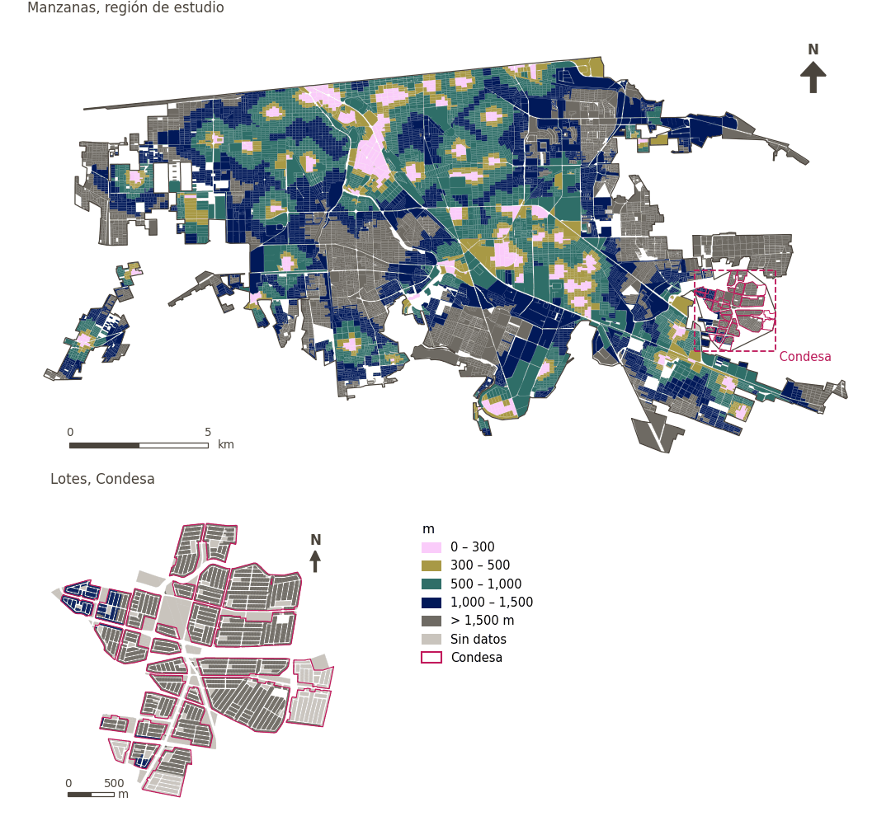

# Transporte público a menos de 300 m

[← Volver al contenido](../README.md)

> Distancia a pie a la parada de transporte público más cercana, puntuada con un umbral suave de 300 m.

## Identificación

| | |
|---|---|
| Identificador | `public_transport` |
| Medida central (hoja de variables) | Acceso al transporte público |
| ID de la hoja / registro | 26 · #26, #223 |
| Variable en puntos de muestra | `sp_walk_nearest_node_pt_any` |
| Variable de área (valor medido) | `avg_walk_dist_pt_any` (m) |
| Puntuación normalizada | `index_uli__public_transport` |
| Dominios (parte del peso) | [Movilidad y transporte](domain_mobility_transport.md) |
| Subdominio | Transporte público |
| Enfoque | Proximidad |
| Mejor si es | valor medido menor (puntuación transformada mayor) |
| Peso efectivo en el índice | `uli` 4.2% · `uli_plain` 4.2% |
| Estado | Se puntúa en el índice publicado |

## Justificación e interpretación

> La cercanía a paradas de autobús mejora la accesibilidad a los equipamientos y servicios de la ciudad, y actúa como motor importante del crecimiento urbano y de la calidad de vida de los residentes. (traducción preliminar del inglés)
>
> — *Registro de indicadores #26: Access to buses: stops (Mobility & Transport / Public Transport)*

- Cita del libro de trabajo: Higgs et al., 2019, 'The Urban Liveability Index: developing a policy-relevant urban liveability composite measure and evaluating associations with transport mode choice'; Suptelo & Sehida, 2020, 'Factors of Post-Industrial Transformations of Urban Sociogeosystems (Case Kharkiv)'
- Lista de artículos: #5: Mahanta (2025), ‘Constructing a city liveability index and evaluating the spatial pattern of liveability of Guwahati city’
- ⚠ la cita del libro de trabajo no nombra a un autor del artículo de la lista; verifique antes de citar (citation_audit.csv)

> Una cobertura amplia de transporte público asegura un acceso equitativo a las oportunidades y servicios de toda la ciudad, y reduce las inequidades en salud relacionadas con la movilidad. (traducción preliminar del inglés)
>
> — *Registro de indicadores #223: Access to public transport (Mobility & Transport / Public Transport)*

- Cita del libro de trabajo: Kashef, 2016, 'Urban liveability across disciplinary and professional boundaries'; Cervero, 2009, 'Transport infrastructure and global competitiveness'; Bassolas et al., 2019, 'Hierarchical organization of urban mobility and its connection with city liveability'; Vuchic, 2017, 'Transportation for Livable Cities'
- Lista de artículos: #27: Alzaim (2024), ‘Integrated Framework for Enhancing Liveability and Ecological Sustainability in UAE Communities’
- ⚠ la cita del libro de trabajo no nombra a un autor del artículo de la lista; verifique antes de citar (citation_audit.csv)

**Cómo leerlo.** … de la población vive a menos de 300 m de una parada de transporte público; en promedio, la más cercana está a … (menor es mejor).

**Access to public transport stops** (Public-transport access; ID 26) (en inglés en la hoja)
- *Cómo calcular (hoja de variables):* USE GHSCI CALCULATION HERE

## Fuentes de datos

**Fuentes declaradas en la configuración:**

- IMIP / CFC public transport stops (suburban transport routes).

**Fuente registrada por GHSCI (diccionario de datos)** (`avg_walk_dist_pt_any`):

- OpenStreetMap: Geofabrik GmbH, 20260815, ODbL, https://download.geofabrik.de/north-america/mexico-latest.osm.pbf, OpenStreetMap Contributors.  Geofabrik GmbH (2026). https://download.geofabrik.de/north-america/mexico-latest.osm.pbf; IMIP / CFC: 2026-05-18, Provided by IMIP via CFC, As per advice from Juan Ernesto Díaz Noguez

**Filtro de destinos:**

- `pt_any` (pt_any): `MX/CFC/cleaned/por_estado/02_baja_california/002_mexicali/imip/equipamiento_combined.fgb` — Filtro de destinos: `"equipamiento_category='transp' AND TIPO != 'TERMINAL INTERIOR DE CARGA (CENTRAL DE SERVICIOS DE CARGA)'"`

**Insumos:** [Paradas de transporte público](pt_stops.md)

## Método: teoría

1. Distancia por la red peatonal desde cada punto de muestra al destino más cercano, `d` (R2), censurada en la banda mayor buscada (1,500 m): un punto sin destino a esa distancia queda sin valor.
2. Puntuación de acceso suave (R10): `s(d) = 1 / (1 + exp(k·(d − t)/t))`, con `t = 300 m` y `k = 5`; `s = 0.5` en el umbral, ≈ 0.99 junto al destino, ≈ 0.007 a `2t`; sin valor → `s = 0`.
3. Normalización AMPI (R11) de `s` con las metas de la región de estudio, luego agregación por dominio e índice (R12) y a áreas (R13).

## Método: práctica

**Recetas:** [R1. Puntos de muestra y red peatonal](../03_recipes.md#r1), [R2. Distancia por la red al destino más cercano, censurada](../03_recipes.md#r2), [R10. Transformaciones: umbrales suaves y escalas escalonadas](../03_recipes.md#r10), [R11. Normalización: el Índice Ajustado de Mazziotta–Pareto (AMPI)](../03_recipes.md#r11), [R12. Agregación: dominios, indicadores compartidos e índice](../03_recipes.md#r12), [R13. De los puntos de muestra a las áreas](../03_recipes.md#r13), [R14. Metas congeladas y recálculo de un escenario](../03_recipes.md#r14)

**Configuración** ([`MX_Mexicali_2025_ULI.yml:1460`](../../data/MX_Mexicali_2025_ULI.yml#L1460)):

```yaml
- variable: sp_walk_nearest_node_pt_any
  name: public_transport
  domains: [mobility_transport]
  transform: {soft_threshold: 300}
  group: {es: 'Acceso al transporte público', en: 'Public-transport access'}
  label: {es: 'Transporte público a menos de 300 m', en: 'Public transport within 300 m'}
  reading: {es: '{access} de la población vive a menos de 300 m de una parada de transporte público; en promedio, la más cercana está a {value}', en: '{access} of the population live within 300 m of a public transport stop; on average the nearest is {value} away'}
  subdomain: {es: 'Transporte público', en: 'Public transport'}
  about:
    es: Distancia a pie a la parada de transporte público más cercana, puntuada con un umbral suave de 300 m.
    en: Walking distance to the nearest public transport stop, scored with a 300 m soft threshold.
  sources:
    - 'IMIP / CFC public transport stops (suburban transport routes).'
```

[`MX_Mexicali_2025_ULI.yml:492`](../../data/MX_Mexicali_2025_ULI.yml#L492):

```yaml
- {name: pt_any,                  category: pt,   variant: lenient, layer: destinations, where: "dest_name = 'pt_any'"}
```

**Código (GHSCI):**

- [`process/subprocesses/_accessibility_spec.py:806`](https://github.com/healthysustainablecities/global-indicators/blob/f03909611dba336c2728fffab6d697779487d0b1/process/subprocesses/_accessibility_spec.py#L806) `_banded_distances()`
- [`process/subprocesses/setup_sp.py:888`](https://github.com/healthysustainablecities/global-indicators/blob/f03909611dba336c2728fffab6d697779487d0b1/process/subprocesses/setup_sp.py#L888) `create_full_nodes()`
- [`process/subprocesses/_composite_index.py:1457`](https://github.com/healthysustainablecities/global-indicators/blob/f03909611dba336c2728fffab6d697779487d0b1/process/subprocesses/_composite_index.py#L1457) `soft_threshold()`
- [`process/subprocesses/_composite_index.py:1819`](https://github.com/healthysustainablecities/global-indicators/blob/f03909611dba336c2728fffab6d697779487d0b1/process/subprocesses/_composite_index.py#L1819) `normalise()`
- [`process/subprocesses/_composite_index.py:1838`](https://github.com/healthysustainablecities/global-indicators/blob/f03909611dba336c2728fffab6d697779487d0b1/process/subprocesses/_composite_index.py#L1838) `mpi_aggregate()`

|  | Variable en puntos de muestra | Transformación | Metas (escala puntuada) | inf – sup | asim. / curt. / empates | Alertas |
|---|---|---|---|---|---|---|
| `uli` | sp_walk_nearest_node_pt_any | acceso suave, umbral de 300 m, k = 5 | −0.433 · 0.064 · 0.561 | 0.000 – 0.993 | 3.44 / 10.89 / 41.0% | skewed |
| `uli_plain` | sp_walk_nearest_node_pt_any | acceso suave, umbral de 300 m, k = 5 | −0.433 · 0.064 · 0.561 | 0.000 – 0.993 | 3.44 / 10.89 / 41.0% | skewed |

## Recálculo (Reimagina Urbano)

Un destino nuevo o retirado, o un cambio en la red peatonal, cambia `d` solo en los puntos cuyo destino más cercano cambia: basta un Dijkstra multi-origen desde los destinos afectados, limitado a 1,500 m, tomando el mínimo con la distancia previa.

Con las metas congeladas del archivo de parámetros (`Ref`, `Mín.`, `Máx.`, R14), una nueva puntuación es `r = 100 ± 60·(x − Ref)/(Máx. − Mín.)` sin volver a resolver metas; el dominio y el índice se recalculan con R12 y se resta 100. Así un escenario se compara con la línea base en la misma escala.

## Resultados

| Medida | Región de estudio (Mexicali con Condesa) | Condesa |
|---|---|---|
| Valor de la región | 882 m | 1,432 m |
| Puntuación de la región (`uli`) | −0.2 | −3.9 |
| Áreas con valor | 9,959 de 14,252 manzanas | 845 de 14,988 lotes |
| Mediana (P25–P75), ponderada | 926 m (610 m – 1,259 m) | 1,409 m (1,297 m – 1,540 m) |
| Rango | 38 m – 3,167 m | 1,089 m – 1,962 m |
| Nada a la distancia buscada | 28.5% | 93.6% |
| Puntuación: mediana (P25–P75) (`uli`) | −3.9 (−3.9 – −3.8) | −3.9 (−3.9 – −3.9) |

*Distribuciones: manzanas de la región de estudio ponderadas por su población censal (2020); lotes de Condesa con igual peso (3.2 residentes supuestos por lote). Los valores de la región son los que GHSCI reporta para cada región en conjunto.*

*Una distancia media se calcula sobre los puntos que encontraron un destino dentro de la distancia buscada; la fila «Nada a la distancia buscada» da la parte de la población de las áreas sin ninguno.*

- Región de estudio: 5.5% de la población vive a menos de 300 m de una parada de transporte público; en promedio, la más cercana está a 882 m.
- Condesa: 0.0% de la población vive a menos de 300 m de una parada de transporte público; en promedio, la más cercana está a 1,432 m.
- Para la región de estudio en su conjunto, el valor es 882 m; en Condesa, 1,432 m. La puntuación de Condesa queda 3.9 puntos por debajo del promedio de la región de estudio (−0.2 para la región de estudio).

## Mapa



*Mapa. Transporte público a menos de 300 m: valor medido (m) por manzana en la región de estudio y por lote en Condesa (recuadro). Clases del tablero; los colores favorables son los claros (menor es mejor).*

## Advertencias y pendientes

- Mexicali no tiene GTFS. Las paradas del IMIP se combinan con las de OpenStreetMap, de modo que una parada presente en ambas se cuenta dos veces en cualquier conteo (no afecta las distancias) (configuración, points_of_interest).
