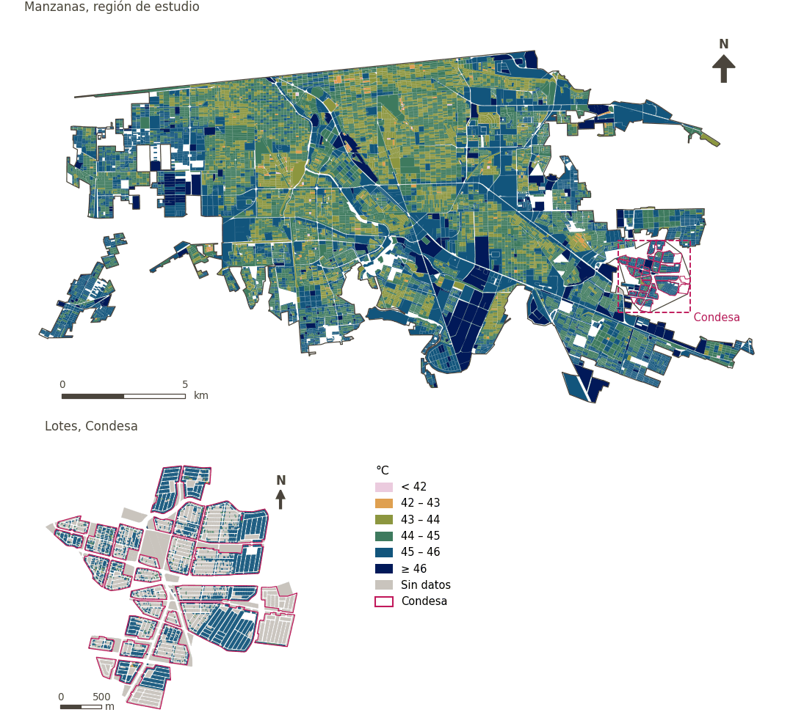

# Confort térmico diurno

[← Volver al contenido](../README.md)

> Índice Universal de Clima Térmico (UTCI) medio durante las horas de sol en superficies peatonales, modelado para el día más caluroso de 2023; menor es mejor.

## Identificación

| | |
|---|---|
| Identificador | `thermal_comfort` |
| Medida central (hoja de variables) | Confort térmico |
| ID de la hoja / registro | 371, 337 · #371, #337, #372 |
| Variable en puntos de muestra | `sp_utci_day_mean` |
| Variable de área (valor medido) | `utci_day_mean` (°C) |
| Puntuación (variante sin atenuación) | `index_uli_plain__thermal_comfort` |
| Dominios (parte del peso) | [Entorno medioambiental](domain_ambient_environment.md) |
| Subdominio | Medioambiente |
| Enfoque | Calidad |
| Mejor si es | menor |
| Peso efectivo en el índice | `uli_plain` 2.4% |
| Estado | Listado pero no puntuado en el índice publicado: Incluido mediante la atenuación de la caminabilidad por confort térmico. Elija la caminabilidad sin atenuación para puntuarlo aquí. |

## Justificación e interpretación

> Mantener las temperaturas urbanas en un rango confortable es vital para la salud física y para prevenir enfermedades relacionadas con el calor y la incomodidad térmica. (traducción preliminar del inglés)
>
> — *Registro de indicadores #371: Temperature (Ambient Environment / Ambient)*

- Cita del libro de trabajo: Kashi et al., 2024, 'Effects of extreme weather events and climate change on cities’ livability'; Alijani et al., 2020, 'A new approach of urban livability in Tehran: Thermal comfort as a primitive indicator'
- Lista de artículos: #16: Kashi (2025), ‘Spatial analysis and ranking of urban districts based on a comprehensive livability approach: the case of Tehran’

> Niveles adecuados de humedad son necesarios para el confort térmico humano y pueden afectar la salud respiratoria y la calidad percibida del entorno urbano. (traducción preliminar del inglés)
>
> — *Registro de indicadores #337: Humidity (Ambient Environment / Ambient)*

- Cita del libro de trabajo: Kashi et al., 2024, 'Effects of extreme weather events and climate change on cities’ livability'; Liang and Li, 2020, 'Resilience and sustainable development goals based social-ecological indicators and assessment of coastal urban areas'
- Lista de artículos: #16: Kashi (2025), ‘Spatial analysis and ranking of urban districts based on a comprehensive livability approach: the case of Tehran’

> La diferencia respecto a la temperatura óptima en julio indica el confort térmico; el calor excesivo en verano se asocia con estrés fisiológico y menor actividad al aire libre. (traducción preliminar del inglés)
>
> — *Registro de indicadores #372: The difference between the average temperature in July and the optimal temperature for human body (Ambient Environment / Ambient)*

- Cita del libro de trabajo: Zhan et al., 2018, 'Assessment and determinants of satisfaction with urban livability in China'; Cao et al., 2019, 'The framework of relationship between built environment and residents healthy based on activity perspective'
- Lista de artículos: #17: Wang (2023), ‘The impact of economic development on urban livability: Evidence from 40 large and medium-sized cities of China’
- ⚠ la cita del libro de trabajo no nombra a un autor del artículo de la lista; verifique antes de citar (citation_audit.csv)

**Cómo leerlo.** UTCI diurno medio de … en superficies peatonales en el día más caluroso de 2023 (menor es mejor).

**Dry bulb air temperature** (Thermal Comfort; ID 371) (en inglés en la hoja)
- *Dudas (hoja):* Rossano, please review according to what is needed by PyThermal comfort (https://pythermalcomfort.readthedocs.io/en/latest/documentation/models.html#universal-thermal-climate-index-utci)

**Mean radiant temperature** (Thermal Comfort; ID 371) (en inglés en la hoja)

**Wind speed 10m above ground level** (Thermal Comfort; ID –) (en inglés en la hoja)

**Relative humidity** (Thermal Comfort; ID 337) (en inglés en la hoja)
- *Notas (hoja):* Could we also calculate it as "The difference between the relative humidity in the hottest month of the year and the optimum humidity for human body"?

## Fuentes de datos

**Fuentes declaradas en la configuración:**

- Rossano Schifanella (WP02): SOLWEIG, forced by Mexicali airport observations for 21 July 2023; UTCI operational polynomial (Bröde et al. 2012).

**Fuente registrada por GHSCI (diccionario de datos)** (`utci_day_mean`):

- Outdoor thermal comfort (UTCI): Rossano Schifanella (WP02); SOLWEIG and the UTCI operational polynomial (Bröde et al. 2012), Terrain from FABDEM v1 (CC BY-NC-SA 4.0, non-commercial); other inputs CC BY 4.0 or public domain

**Insumos:** [Confort térmico exterior (UTCI)](utci.md)

## Método: teoría

1. UTCI (Índice Universal de Clima Térmico) diurno medio, modelado con SOLWEIG para el 21 de julio de 2023 sobre superficies peatonales y resumido por área (paquete de trabajo 2); unidades con menos de 100 píxeles peatonales se enmascaran (R7).
2. Replicado a cada punto de muestra desde su celda de 100 m.
3. En el índice publicado entra solo a través de la atenuación de la caminabilidad (R9). En `uli_plain` se normaliza (R11, menor es mejor) y se agrega (R12, R13).

*En el índice publicado este indicador no se puntúa; la variante sin atenuación (uli_plain) sí lo puntúa.*

## Método: práctica

**Recetas:** [R1. Puntos de muestra y red peatonal](../03_recipes.md#r1), [R7. Vinculación de indicadores preparados externamente](../03_recipes.md#r7), [R9. Caminabilidad y su atenuación por confort térmico](../03_recipes.md#r9), [R11. Normalización: el Índice Ajustado de Mazziotta–Pareto (AMPI)](../03_recipes.md#r11), [R12. Agregación: dominios, indicadores compartidos e índice](../03_recipes.md#r12), [R13. De los puntos de muestra a las áreas](../03_recipes.md#r13), [R14. Metas congeladas y recálculo de un escenario](../03_recipes.md#r14)

**Configuración** ([`MX_Mexicali_2025_ULI.yml:1264`](../../data/MX_Mexicali_2025_ULI.yml#L1264)):

```yaml
- variable: sp_utci_day_mean
  name: thermal_comfort
  domains: [ambient_environment]
  polarity: negative
  lens: quality
  active: false
  inactive_reason:
    es: Incluido mediante la atenuación de la caminabilidad por confort térmico. Elija la caminabilidad sin atenuación para puntuarlo aquí.
    en: Included through walkability's thermal comfort attenuation. Choose walkability without attenuation to score it here.
  group: {es: 'Confort térmico', en: 'Thermal comfort'}
  label: {es: 'Confort térmico diurno', en: 'Daytime thermal comfort'}
  reading: {es: 'UTCI diurno medio de {value} en superficies peatonales en el día más caluroso de 2023', en: 'Mean daytime UTCI of {value} on pedestrian surfaces on the hottest day of 2023'}
  subdomain: {es: 'Medioambiente', en: 'Ambient'}
  about:
    es: Índice Universal de Clima Térmico (UTCI) medio durante las horas de sol en superficies peatonales, modelado para el día más caluroso de 2023; menor es mejor.
    en: Mean Universal Thermal Climate Index (UTCI) over sunlit hours on pedestrian surfaces, modelled for the hottest day of 2023; lower is better.
  sources:
    - 'Rossano Schifanella (WP02): SOLWEIG, forced by Mexicali airport observations for 21 July 2023; UTCI operational polynomial (Bröde et al. 2012).'
```

**Código (GHSCI):**

- [`process/subprocesses/_linkage_indicators.py:512`](https://github.com/healthysustainablecities/global-indicators/blob/f03909611dba336c2728fffab6d697779487d0b1/process/subprocesses/_linkage_indicators.py#L512) `apply_rules()`
- [`process/subprocesses/_linkage_indicators.py:537`](https://github.com/healthysustainablecities/global-indicators/blob/f03909611dba336c2728fffab6d697779487d0b1/process/subprocesses/_linkage_indicators.py#L537) `sample_point_values()`
- [`process/subprocesses/_composite_index.py:1819`](https://github.com/healthysustainablecities/global-indicators/blob/f03909611dba336c2728fffab6d697779487d0b1/process/subprocesses/_composite_index.py#L1819) `normalise()`
- [`process/subprocesses/_composite_index.py:1838`](https://github.com/healthysustainablecities/global-indicators/blob/f03909611dba336c2728fffab6d697779487d0b1/process/subprocesses/_composite_index.py#L1838) `mpi_aggregate()`

|  | Variable en puntos de muestra | Transformación | Metas (escala puntuada) | inf – sup | asim. / curt. / empates | Alertas |
|---|---|---|---|---|---|---|
| `uli_plain` | sp_utci_day_mean | tal cual | 41.938 · 44.949 · 47.960 | 40.831 – 46.853 | −0.16 / −0.39 / 0.2% | ninguna |

## Recálculo (Reimagina Urbano)

El valor viene de un paquete de trabajo externo: un escenario (p. ej., más vegetación) sustituye el valor del área y se replica a sus puntos de muestra.

Con las metas congeladas del archivo de parámetros (`Ref`, `Mín.`, `Máx.`, R14), una nueva puntuación es `r = 100 ± 60·(x − Ref)/(Máx. − Mín.)` sin volver a resolver metas; el dominio y el índice se recalculan con R12 y se resta 100. Así un escenario se compara con la línea base en la misma escala.

## Resultados

| Medida | Región de estudio (Mexicali con Condesa) | Condesa |
|---|---|---|
| Valor de la región | 45.1 °C | 45.5 °C |
| Puntuación de la región (`uli_plain`) | +3.8 | −5.6 |
| Áreas con valor | 14,200 de 14,252 manzanas | 7,766 de 14,988 lotes |
| Mediana (P25–P75), ponderada | 44.3 °C (43.9 °C – 44.8 °C) | 45.9 °C (45.6 °C – 46.0 °C) |
| Rango | 40.4 °C – 46.7 °C | 40.4 °C – 46.4 °C |
| Puntuación: mediana (P25–P75) (`uli_plain`) | +3.3 (−0.4 – +6.2) | −5.9 (−8.3 – −3.4) |

*Distribuciones: manzanas de la región de estudio ponderadas por su población censal (2020); lotes de Condesa con igual peso (3.2 residentes supuestos por lote). Los valores de la región son los que GHSCI reporta para cada región en conjunto.*

- Región de estudio: UTCI diurno medio de 45.1 °C en superficies peatonales en el día más caluroso de 2023.
- Condesa: UTCI diurno medio de 45.5 °C en superficies peatonales en el día más caluroso de 2023.
- Para la región de estudio en su conjunto, el valor es 45.1 °C; en Condesa, 45.5 °C. La puntuación de Condesa queda 5.6 puntos por debajo del promedio de la región de estudio (+3.8 para la región de estudio).

## Mapa



*Mapa. Confort térmico diurno: valor medido (°C) por manzana en la región de estudio y por lote en Condesa (recuadro). Clases del tablero; los colores favorables son los claros (menor es mejor).*

## Advertencias y pendientes

- La temperatura del aire, la humedad y el viento son uniformes en el modelo, de modo que solo varía la temperatura radiante (sol y sombra); la mayoría de los valores exceden el rango de ajuste del polinomio UTCI; las comparaciones dentro de un barrio son sólidas, no así las clasificaciones de barrios a kilómetros de distancia (configuración, linkage_indicators.utci; README_mexicali_utci.md).
- Solo se usa el confort térmico diurno: el UTCI nocturno varía fracciones de grado en la ciudad (30.3–30.6 °C) (configuración).
