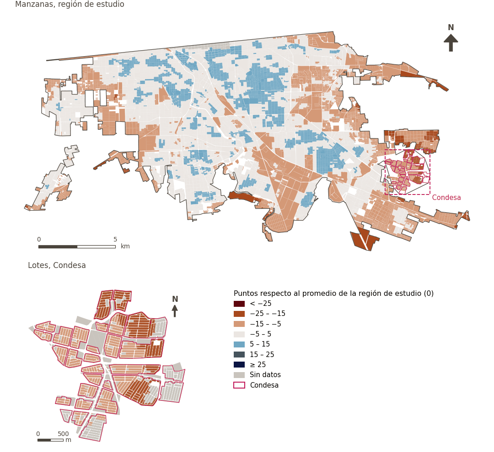

# Índice de entornos vivibles para Mexicali

[← Volver al contenido](../README.md)

> Promedio de las puntuaciones de los dominios del Índice de entornos vivibles para Mexicali, cada una resumen de sus subindicadores normalizados, menos una penalización por la variación entre dominios que premia un desempeño equilibrado. Se expresa en puntos por encima o por debajo del promedio de la región de estudio (0).

El Índice de entornos vivibles se basa en el Índice ajustado de Mazziotta-Pareto (AMPI): cada subindicador se reescala de modo que 0 es el promedio de la región de estudio (su media en todos los puntos de muestra), y las puntuaciones son puntos por encima o por debajo de él. Cada dominio es la media ponderada de sus subindicadores menos una penalización por el desequilibrio entre ellos, y el índice es, del mismo modo, la media de los dominios menos una penalización por el desequilibrio entre dominios. Un subindicador que atañe a varios dominios cuenta en cada uno con una parte igual de su peso (un tercio en cada uno de tres), de modo que en total no pesa más que uno de un solo dominio. Se calcula en puntos de muestra a lo largo de la red peatonal, se promedia a las celdas de la cuadrícula y, ponderado por población, a áreas mayores.

Índice publicado: la caminabilidad entra atenuada por el confort térmico diurno (`sp_walk_idx_300_tm`), y el confort térmico no se puntúa por separado. Véase también la variante [Índice de entornos vivibles para Mexicali: Caminabilidad (300 m), sin atenuación por confort térmico](uli_plain.md).

## Dominios

| Dominios | n | Puntuación de la región: Región de estudio (Mexicali con Condesa) | Condesa |
|---|---|---|---|
| [Entorno medioambiental](domain_ambient_environment.md) | 8 | −2.6 | +2.3 |
| [Ambiente construido](domain_built_environment.md) | 8 | +2.0 | −17.8 |
| [Desarrollo económico](domain_economic_development.md) | 6 | +1.9 | −14.8 |
| [Vivienda](domain_housing.md) | – | – | – |
| [Movilidad y transporte](domain_mobility_transport.md) | 10 | +2.4 | −15.4 |
| [Seguridad y protección](domain_safety.md) | 5 | +2.2 | −20.7 |
| [Infraestructura social](domain_social_infrastructure.md) | 13 | +2.4 | −12.1 |
| [Características sociodemográficas](domain_sociodemographics.md) | – | – | – |

## Método: teoría

```text
r_i      = 100 ± 60 · (x_i − Ref_i) / (Max_i − Min_i)                 (R11)
domain_d = M_d − S_d · (S_d / M_d),  w_i ∝ weight_i · share_{i,d}       (R12)
index    = M − S · (S / M)  over the six scored domains, equal weights
reported = index − 100   (0 = study region average)
```

**Recetas:** [R10. Transformaciones: umbrales suaves y escalas escalonadas](../03_recipes.md#r10), [R11. Normalización: el Índice Ajustado de Mazziotta–Pareto (AMPI)](../03_recipes.md#r11), [R12. Agregación: dominios, indicadores compartidos e índice](../03_recipes.md#r12), [R13. De los puntos de muestra a las áreas](../03_recipes.md#r13), [R14. Metas congeladas y recálculo de un escenario](../03_recipes.md#r14)

## Método: práctica

**Configuración:** [`MX_Mexicali_2025_ULI.yml:1019`](../../data/MX_Mexicali_2025_ULI.yml#L1019); [`MX_Mexicali_2025_ULI_composite_uli_parameters.yml`](../../data/MX_Mexicali_2025_ULI_composite_uli_parameters.yml)

**Código (GHSCI):** [`process/subprocesses/_composite_index.py:1602`](https://github.com/healthysustainablecities/global-indicators/blob/f03909611dba336c2728fffab6d697779487d0b1/process/subprocesses/_composite_index.py#L1602) `resolve_parameters()`, [`process/subprocesses/_composite_index.py:1874`](https://github.com/healthysustainablecities/global-indicators/blob/f03909611dba336c2728fffab6d697779487d0b1/process/subprocesses/_composite_index.py#L1874) `score()`, [`process/subprocesses/_composite_index.py:1838`](https://github.com/healthysustainablecities/global-indicators/blob/f03909611dba336c2728fffab6d697779487d0b1/process/subprocesses/_composite_index.py#L1838) `mpi_aggregate()`, [`process/subprocesses/_composite_index.py:2062`](https://github.com/healthysustainablecities/global-indicators/blob/f03909611dba336c2728fffab6d697779487d0b1/process/subprocesses/_composite_index.py#L2062) `propagate()`

## Recálculo (Reimagina Urbano)

Con las metas congeladas del archivo de parámetros (`Ref`, `Mín.`, `Máx.`, R14), una nueva puntuación es `r = 100 ± 60·(x − Ref)/(Máx. − Mín.)` sin volver a resolver metas; el dominio y el índice se recalculan con R12 y se resta 100. Así un escenario se compara con la línea base en la misma escala.

[R14. Metas congeladas y recálculo de un escenario](../03_recipes.md#r14)

## Resultados

| Medida | Región de estudio (Mexicali con Condesa) | Condesa |
|---|---|---|
| Puntuación de la región (`uli`) | +1.0 | −13.8 |
| Puntuación de la región (`uli_mean`) | +1.4 | −12.9 |
| Puntuación de la región (`uli_penalty`) | 0.39 | 0.96 |
| Áreas con valor | 14,145 de 14,252 manzanas | 12,186 de 14,988 lotes |
| Mediana (P25–P75), ponderada | +0.9 (−3.1 – +4.1) | −12.6 (−17.8 – −11.1) |
| Rango | −20.3 – +14.9 | −20.7 – −3.7 |

*Distribuciones: manzanas de la región de estudio ponderadas por su población censal (2020); lotes de Condesa con igual peso (3.2 residentes supuestos por lote). Los valores de la región son los que GHSCI reporta para cada región en conjunto.*

- La región de estudio (Mexicali con Condesa) puntúa +1.0, y Condesa −13.8: 13.8 puntos por debajo del promedio de la región de estudio. La penalización mide el desequilibrio entre dominios (`_penalty`, sin centrar).

## Mapa



*Mapa. Índice de entornos vivibles para Mexicali: puntuación por manzana en la región de estudio y por lote en Condesa (recuadro), en puntos respecto al promedio de la región de estudio (0); azul es mejor.*

## Fuentes declaradas en la configuración

- Mazziotta, M. & Pareto, A. (2018) Measuring well-being over time: the Adjusted Mazziotta-Pareto Index versus other non-compensatory indices. Social Indicators Research 136, 967-976.
- Mazziotta, M. & Pareto, A. (2022) Weighted composite indices: the case of the Mazziotta-Pareto Index. Rivista Italiana di Economia Demografia e Statistica 76(4), 17-26.
- Higgs, C. et al. (2019) The Urban Liveability Index: developing a policy-relevant urban liveability composite measure and evaluating associations with transport mode choice. International Journal of Health Geographics 18, 14.
- OECD & JRC (2008) Handbook on Constructing Composite Indicators: Methodology and User Guide. OECD Publishing, Paris.
- Population: GHS-POP R2023A (JRC) and INEGI Censo 2020; Condesa lots at an assumed 3.2 residents each.

## Advertencias y pendientes

- El índice es provisional: los indicadores de cada dominio y la forma de calcularlo siguen en revisión.
