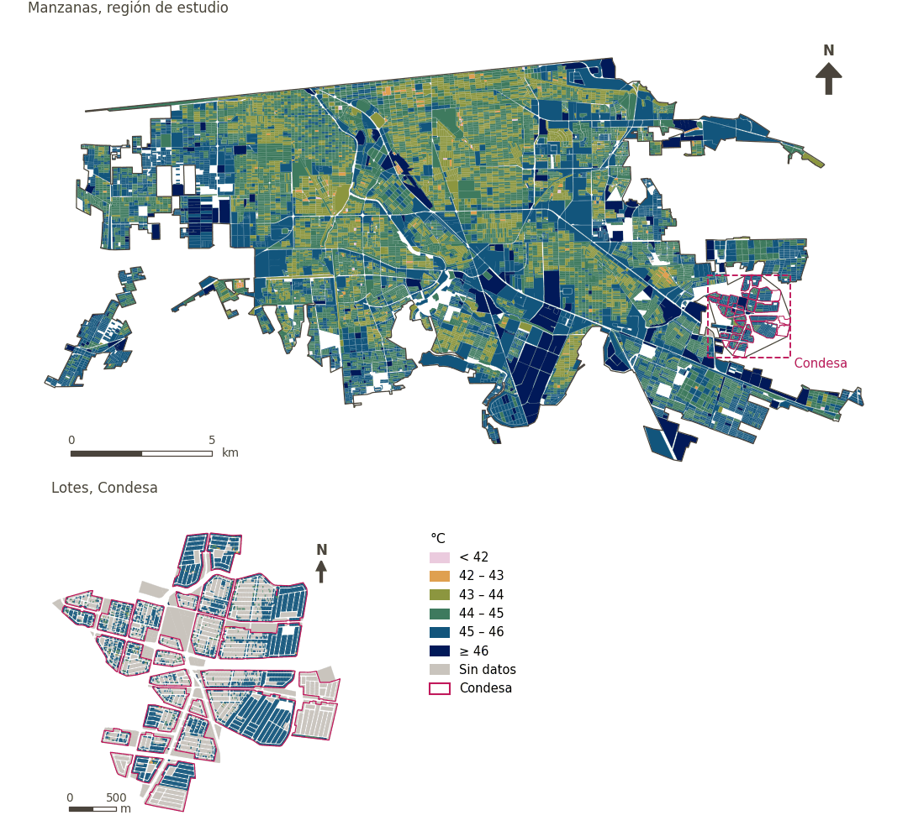

# Confort térmico exterior (UTCI)

[← Volver al contenido](../README.md)

Índice Universal de Clima Térmico modelado por el paquete de trabajo 2 (Rossano Schifanella) con SOLWEIG para el día más caluroso de 2023 (21 de julio; temperatura máxima 48.5 °C), forzado con observaciones del aeropuerto de Mexicali, sobre superficies peatonales, y convertido a UTCI con el polinomio operativo (Bröde et al. 2012). Se entregó resumido para las áreas de referencia (cuadrícula, AGEB, manzanas, lotes y fraccionamientos) y se vincula por identificador. Las unidades con menos de 100 píxeles peatonales se enmascaran (`reliable`).

- `utci_day_mean`: media del UTCI medio diurno (horas con sol); es el insumo de la atenuación de la caminabilidad y el indicador de confort térmico.
- `utci_peak`: media del UTCI máximo diario (efectivamente a las 17:00); vinculado como referencia, no se usa en el índice.

| Variable en puntos de muestra | Variable de área (valor medido) | Descripción | Región de estudio (Mexicali con Condesa) | Condesa |
|---|---|---|---|---|
| `sp_utci_day_mean` | `utci_day_mean` | Confort térmico diurno (UTCI medio) | 45.1 °C | 45.5 °C |
| `sp_utci_peak` | `utci_peak` | UTCI máximo (17:00) | 52.8 °C | 52.9 °C |

| Columna | Nombre | Unidades | Dirección |
|---|---|---|---|
| `utci_day_mean` | Confort térmico diurno (UTCI medio) | °C | lower_is_better |
| `utci_peak` | UTCI máximo (17:00) | °C | lower_is_better |

- `data`: MX/UTCI - 2026-08-25/mexicali_utci_2023-07-21.gpkg
- `match`: id
- `id`: area_id
- `mask`: reliable
- `source`: Rossano Schifanella (WP02); SOLWEIG and the UTCI operational polynomial (Bröde et al. 2012)
- `licence`: Terrain from FABDEM v1 (CC BY-NC-SA 4.0, non-commercial); other inputs CC BY 4.0 or public domain
- `notes`: Modelled day 2023-07-21 (Tmax 48.5 °C).  See README_mexicali_utci.md, sections 3.1 and 5, for forcing and limitations.

## Método: práctica

**Recetas:** [R7. Vinculación de indicadores preparados externamente](../03_recipes.md#r7)

**Configuración** ([`MX_Mexicali_2025_ULI.yml:770`](../../data/MX_Mexicali_2025_ULI.yml#L770)):

```yaml
utci:
  data: MX/UTCI - 2026-08-25/mexicali_utci_2023-07-21.gpkg
  match: id
  id: area_id
  mask: reliable
  label: {es: Confort térmico exterior (UTCI), en: Outdoor thermal comfort (UTCI)}
  source: Rossano Schifanella (WP02); SOLWEIG and the UTCI operational polynomial (Bröde et al. 2012)
  licence: Terrain from FABDEM v1 (CC BY-NC-SA 4.0, non-commercial); other inputs CC BY 4.0 or public domain
  notes: 'Modelled day 2023-07-21 (Tmax 48.5 °C).  See README_mexicali_utci.md, sections 3.1 and 5, for forcing and limitations.'
  columns:
    utci_day_mean:
      label: {es: 'Confort térmico diurno (UTCI medio)', en: 'Daytime thermal comfort (mean UTCI)'}
      units: °C
      direction: lower_is_better
      description: Unit mean of the daytime mean Universal Thermal Climate Index (hours with sunlight), over pedestrian surfaces, on the hottest day of 2023.
    utci_peak:
      label: {es: 'UTCI máximo (17:00)', en: 'Peak UTCI (17:00)'}
      units: °C
      direction: lower_is_better
      description: Unit mean of the daily maximum Universal Thermal Climate Index (effectively 17:00), over pedestrian surfaces, on the hottest day of 2023.
  areas:
    grid: grid_100m
    agebs: agebs
    manzanas: manzanas
    condesa_lotes: {layer: condesa_lotes, boundary_id: id}
    condesa_fraccionamientos: {layer: condesa_fraccionamientos, boundary_id: fid}
    region_mexicali: region
    region_condesa: region
  ## the 100 m grid tiles the study region: sample points lie on streets,
  ## between blocks, so a block layer would leave most of them unvalued
  sample_points: [grid_100m]
```

**Código (GHSCI):**

- [`process/subprocesses/_linkage_indicators.py:512`](https://github.com/healthysustainablecities/global-indicators/blob/f03909611dba336c2728fffab6d697779487d0b1/process/subprocesses/_linkage_indicators.py#L512) `apply_rules()`
- [`process/subprocesses/_linkage_indicators.py:537`](https://github.com/healthysustainablecities/global-indicators/blob/f03909611dba336c2728fffab6d697779487d0b1/process/subprocesses/_linkage_indicators.py#L537) `sample_point_values()`

## Lo usan

[Confort térmico diurno](thermal_comfort.md), [Caminabilidad (300 m), atenuada por confort térmico](walkability.md)

## Resultados

| Medida | Región de estudio (Mexicali con Condesa) | Condesa |
|---|---|---|
| Valor de la región | 45.1 °C | 45.5 °C |
| Áreas con valor | 14,200 de 14,252 manzanas | 7,766 de 14,988 lotes |
| Mediana (P25–P75), ponderada | 44.3 °C (43.9 °C – 44.8 °C) | 45.9 °C (45.6 °C – 46.0 °C) |
| Rango | 40.4 °C – 46.7 °C | 40.4 °C – 46.4 °C |

*Distribuciones: manzanas de la región de estudio ponderadas por su población censal (2020); lotes de Condesa con igual peso (3.2 residentes supuestos por lote). Los valores de la región son los que GHSCI reporta para cada región en conjunto.*

## Mapa



*Mapa. Confort térmico exterior (UTCI): valor medido (°C) por manzana en la región de estudio y por lote en Condesa (recuadro). Clases del tablero; los colores favorables son los claros (menor es mejor).*
