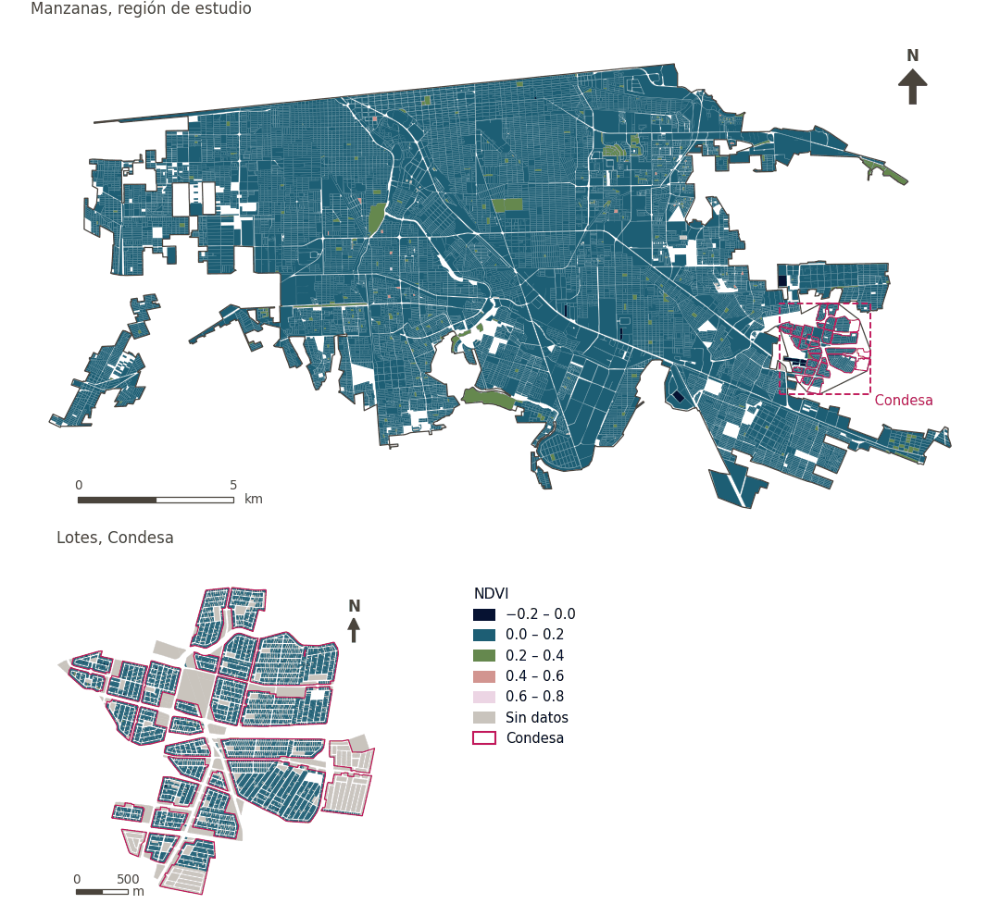

# Cobertura vegetal (NDVI)

[← Volver al contenido](../README.md)

> Índice de vegetación de diferencia normalizada (NDVI) medio; mayor es mejor.

## Identificación

| | |
|---|---|
| Identificador | `vegetation` |
| Medida central (hoja de variables) | Vegetación y sombra |
| ID de la hoja / registro | 135, 378, 389 · #135, #389, #385 |
| Variable en puntos de muestra | `sp_ext_ndvi` |
| Variable de área (valor medido) | `ext_ndvi` (NDVI) |
| Puntuación normalizada | `index_uli__vegetation` |
| Dominios (parte del peso) | [Entorno medioambiental](domain_ambient_environment.md) (50%), [Ambiente construido](domain_built_environment.md) (50%) |
| Subdominio | Entorno medioambiental: Medioambiente; Ambiente construido: Infraestructura verde y azul |
| Enfoque | Calidad |
| Mejor si es | mayor |
| Peso efectivo en el índice | `uli` 4.0% · `uli_plain` 3.8% |
| Estado | Se puntúa en el índice publicado |

## Justificación e interpretación

> El índice de vegetación de diferencia normalizada (NDVI) se usa para dar seguimiento al verdor de la ciudad, que favorece la salud mental y la sostenibilidad ambiental. (traducción preliminar del inglés)
>
> — *Registro de indicadores #135: NDVI (Ambient Environment / Ambient)*

- Cita del libro de trabajo: Sachs et al., 2019, 'Six transformations to achieve the sustainable development goals'; Lowe et al., 2015, 'Planning healthy, liveable and sustainable cities: how can indicators inform policy?'
- Lista de artículos: #13: Alderton (2021), ‘Measuring and monitoring liveability in a low-to-middle income country: a proof-of-concept for Bangkok, Thailand and lessons from an international partnership’
- ⚠ la cita del libro de trabajo no nombra a un autor del artículo de la lista; verifique antes de citar (citation_audit.csv)

> La cobertura vegetal media en la ciudad ayuda a mitigar el efecto de isla de calor urbana y aporta beneficios para la salud psicológica mediante el contacto con la naturaleza. (traducción preliminar del inglés)
>
> — *Registro de indicadores #389: Vegetation percent (Ambient Environment / Ambient)*

- Cita del libro de trabajo: Lowe et al., 2015, 'Planning healthy, liveable and sustainable cities: how can indicators inform policy?'; Sachs et al., 2019, 'Six transformations to achieve the sustainable development goals'
- Lista de artículos: #13: Alderton (2021), ‘Measuring and monitoring liveability in a low-to-middle income country: a proof-of-concept for Bangkok, Thailand and lessons from an international partnership’
- ⚠ la cita del libro de trabajo no nombra a un autor del artículo de la lista; verifique antes de citar (citation_audit.csv)

> La vegetación como tipo de uso de suelo es la categoría óptima para el asentamiento humano, y favorece directamente la habitabilidad y el bienestar mediante servicios ecosistémicos y áreas verdes. (traducción preliminar del inglés)
>
> — *Registro de indicadores #385: Vegetation (Ambient Environment / Resources)*

- Cita del libro de trabajo: No external citations provided for this indicator.
- Lista de artículos: #28: Chen (2023), ‘Evaluation of the livability of arid urban environments under global warming: A multi-parameter approach’
- ⚠ la cita del libro de trabajo no nombra a un autor del artículo de la lista; verifique antes de citar (citation_audit.csv)

**Cómo leerlo.** Índice de vegetación (NDVI) medio de ….

**Vegetation coverage percent** (Vegetation and shade; ID 135, 378; 389) (en inglés en la hoja)
- *Cómo calcular (hoja de variables):* Mean NDVI, fractional vegetation, or percent vegetated land. Vegetation Percent (mean); Vegetation Percent (standard deviation)
- *Notas (hoja):* Do not equate with accessible cooling.

## Fuentes de datos

**Fuentes declaradas en la configuración:**

- Mexicali ULI work packages (final_indicators.gpkg, 22 September 2026).

**Fuente registrada por GHSCI (diccionario de datos)** (`ext_ndvi`):

- Work package indicators: Mexicali ULI work packages (final_indicators.gpkg; see excel_work_sheet_key.xlsx)

**Insumos:** [Indicadores de los paquetes de trabajo (vinculados)](work_package_layers.md)

## Método: teoría

1. Valor preparado fuera de GHSCI por un paquete de trabajo y vinculado a las áreas de referencia (R7: por geometría contra las áreas de referencia).
2. Replicado a cada punto de muestra desde el área que lo contiene (`grid`, `condesa_lotes (15 m)`, `manzanas (30 m)`).
3. Normalización AMPI (R11) del valor tal cual, agregación (R12) y áreas (R13).

## Método: práctica

**Recetas:** [R1. Puntos de muestra y red peatonal](../03_recipes.md#r1), [R7. Vinculación de indicadores preparados externamente](../03_recipes.md#r7), [R11. Normalización: el Índice Ajustado de Mazziotta–Pareto (AMPI)](../03_recipes.md#r11), [R12. Agregación: dominios, indicadores compartidos e índice](../03_recipes.md#r12), [R13. De los puntos de muestra a las áreas](../03_recipes.md#r13), [R14. Metas congeladas y recálculo de un escenario](../03_recipes.md#r14)

**Configuración** ([`MX_Mexicali_2025_ULI.yml:1299`](../../data/MX_Mexicali_2025_ULI.yml#L1299)):

```yaml
- variable: sp_ext_ndvi
  name: vegetation
  domains: [ambient_environment, built_environment]
  polarity: positive
  lens: quality
  group: {es: 'Vegetación y sombra', en: 'Vegetation and shade'}
  label: {es: 'Cobertura vegetal (NDVI)', en: 'Vegetation cover (NDVI)'}
  reading: {es: 'Índice de vegetación (NDVI) medio de {value}', en: 'Mean vegetation index (NDVI) of {value}'}
  subdomain:
    ambient_environment: {es: 'Medioambiente', en: 'Ambient'}
    built_environment: {es: 'Infraestructura verde y azul', en: 'Green and blue infrastructure'}
  about:
    es: Índice de vegetación de diferencia normalizada (NDVI) medio; mayor es mejor.
    en: Mean normalised difference vegetation index (NDVI); higher is better.
  sources:
    - 'Mexicali ULI work packages (final_indicators.gpkg, 22 September 2026).'
```

**Código (GHSCI):**

- [`process/subprocesses/_linkage_indicators.py:403`](https://github.com/healthysustainablecities/global-indicators/blob/f03909611dba336c2728fffab6d697779487d0b1/process/subprocesses/_linkage_indicators.py#L403) `match_by_geometry()`
- [`process/subprocesses/_linkage_indicators.py:537`](https://github.com/healthysustainablecities/global-indicators/blob/f03909611dba336c2728fffab6d697779487d0b1/process/subprocesses/_linkage_indicators.py#L537) `sample_point_values()`
- [`process/subprocesses/_composite_index.py:1819`](https://github.com/healthysustainablecities/global-indicators/blob/f03909611dba336c2728fffab6d697779487d0b1/process/subprocesses/_composite_index.py#L1819) `normalise()`
- [`process/subprocesses/_composite_index.py:1838`](https://github.com/healthysustainablecities/global-indicators/blob/f03909611dba336c2728fffab6d697779487d0b1/process/subprocesses/_composite_index.py#L1838) `mpi_aggregate()`

|  | Variable en puntos de muestra | Transformación | Metas (escala puntuada) | inf – sup | asim. / curt. / empates | Alertas |
|---|---|---|---|---|---|---|
| `uli` | sp_ext_ndvi | tal cual | −0.251 · 0.082 · 0.415 | −0.031 – 0.636 | 2.37 / 12.56 / 0.1% | skewed |
| `uli_plain` | sp_ext_ndvi | tal cual | −0.251 · 0.082 · 0.415 | −0.031 – 0.636 | 2.37 / 12.56 / 0.1% | skewed |

## Recálculo (Reimagina Urbano)

El valor viene de un paquete de trabajo externo: un escenario (p. ej., más vegetación) sustituye el valor del área y se replica a sus puntos de muestra.

Con las metas congeladas del archivo de parámetros (`Ref`, `Mín.`, `Máx.`, R14), una nueva puntuación es `r = 100 ± 60·(x − Ref)/(Máx. − Mín.)` sin volver a resolver metas; el dominio y el índice se recalculan con R12 y se resta 100. Así un escenario se compara con la línea base en la misma escala.

## Resultados

| Medida | Región de estudio (Mexicali con Condesa) | Condesa |
|---|---|---|
| Valor de la región | 0.08 | 0.05 |
| Puntuación de la región (`uli`) | −0.2 | −1.8 |
| Áreas con valor | 14,200 de 14,252 manzanas | 11,279 de 14,988 lotes |
| Mediana (P25–P75), ponderada | 0.07 (0.06 – 0.08) | 0.04 (0.03 – 0.06) |
| Rango | −0.03 – 0.61 | −0.08 – 0.34 |
| Puntuación: mediana (P25–P75) (`uli`) | −0.4 (−1.4 – +0.8) | −2.3 (−3.3 – −0.8) |

*Distribuciones: manzanas de la región de estudio ponderadas por su población censal (2020); lotes de Condesa con igual peso (3.2 residentes supuestos por lote). Los valores de la región son los que GHSCI reporta para cada región en conjunto.*

- Región de estudio: Índice de vegetación (NDVI) medio de 0.08.
- Condesa: Índice de vegetación (NDVI) medio de 0.05.
- Para la región de estudio en su conjunto, el valor es 0.08; en Condesa, 0.05. La puntuación de Condesa queda 1.8 puntos por debajo del promedio de la región de estudio (−0.2 para la región de estudio).

## Mapa



*Mapa. Cobertura vegetal (NDVI): valor medido (NDVI) por manzana en la región de estudio y por lote en Condesa (recuadro). Clases del tablero; los colores favorables son los claros (mayor es mejor).*

## Advertencias y pendientes

- No debe equipararse con enfriamiento accesible (nota de la hoja). La cobertura arbórea, mejor aproximación a la sombra, cubre solo 210 manzanas y no se usa (configuración).
