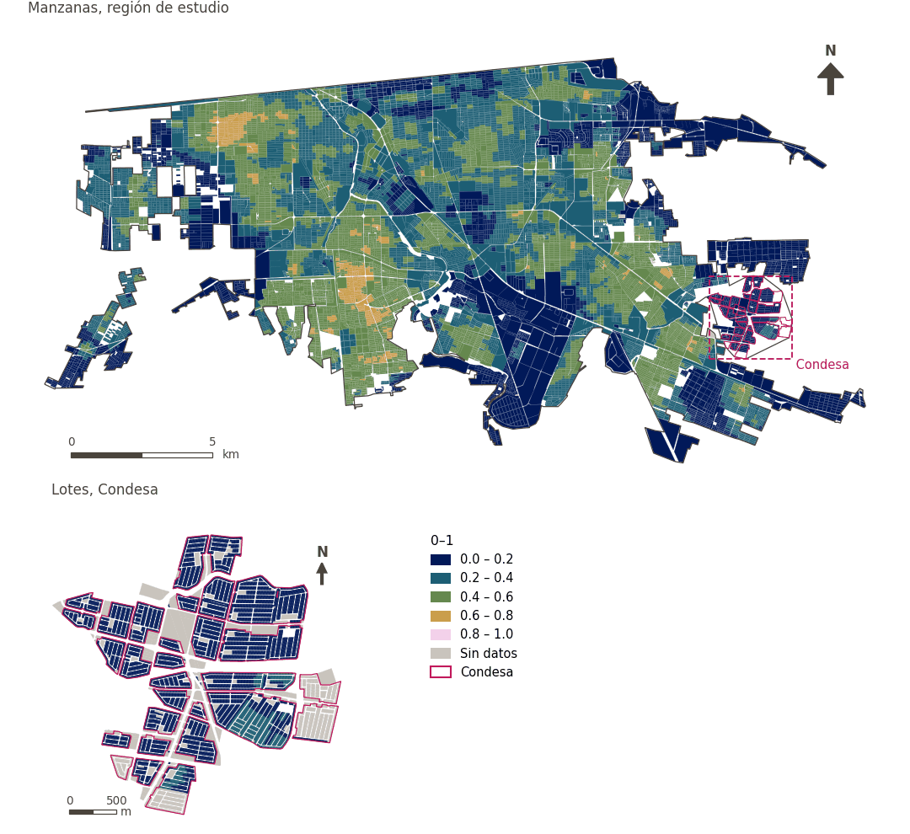

# Caminabilidad (300 m), atenuada por confort térmico

[← Volver al contenido](../README.md)

> Suma de puntuaciones z del acceso a mercado de alimentos frescos, tienda de conveniencia y transporte público a 300 m, la densidad de población y la densidad de intersecciones. Por defecto, su rango percentil se atenúa según el confort térmico diurno, hasta la mitad en los lugares más calurosos.

## Identificación

| | |
|---|---|
| Identificador | `walkability` |
| Medida central (hoja de variables) | Índice de caminabilidad |
| ID de la hoja / registro | 362, 74, 230, 120, 116 · #74, #362 |
| Variable en puntos de muestra | `sp_walk_idx_300_tm` |
| Variable de área (valor medido) | `walk_idx_300_tm` (0–1) |
| Puntuación normalizada | `index_uli__walkability` |
| Puntuación (variante sin atenuación) | `index_uli_plain__walkability` |
| Dominios (parte del peso) | [Ambiente construido](domain_built_environment.md) (33%), [Movilidad y transporte](domain_mobility_transport.md) (33%), [Infraestructura social](domain_social_infrastructure.md) (33%) |
| Subdominio | Ambiente construido: Diseño urbano; Movilidad y transporte: Movilidad activa; Infraestructura social: Servicios públicos |
| Enfoque | Accesibilidad |
| Mejor si es | mayor |
| Peso efectivo en el índice | `uli` 3.7% · `uli_plain` 3.7% |
| Estado | Se puntúa en el índice publicado |

## Justificación e interpretación

> Los entornos urbanos favorables a la caminata promueven la seguridad y estilos de vida saludables mediante un diseño centrado en las personas. (traducción preliminar del inglés)
>
> — *Registro de indicadores #74: Walkability Index (Safety / Road Safety)*

- Cita del libro de trabajo: Skalicky & Čerpes, 2019, 'Comprehensive assessment methodology for liveable residential environment'
- Lista de artículos: #23: Sarkar (2020), ‘Socio-physical liveability through socio-spatiality in low-income resettlement archetypes - A case of slum rehabilitation housing in Mumbai, India.’
- ⚠ la cita del libro de trabajo no nombra a un autor del artículo de la lista; verifique antes de citar (citation_audit.csv)

> Una red peatonal bien conectada promueve un entorno seguro y favorece directamente la salud física de los residentes al fomentar la caminata. (traducción preliminar del inglés)
>
> — *Registro de indicadores #362: Street connectivity (Built Environment / Urban Morphology)*

- Cita del libro de trabajo: Ahmed, 2012, 'Urban social sustainability: A study of the Emirati local communities in Al Ain'
- Lista de artículos: #23: Sarkar (2020), ‘Socio-physical liveability through socio-spatiality in low-income resettlement archetypes - A case of slum rehabilitation housing in Mumbai, India.’
- ⚠ la cita del libro de trabajo no nombra a un autor del artículo de la lista; verifique antes de citar (citation_audit.csv)

**Cómo leerlo.** Puntuación media de caminabilidad de … (mayor es más caminable).

**Street connectivity** (Walkability Index; ID 362,74) (en inglés en la hoja)
- *Cómo calcular (hoja de variables):* USE GHSCI CALCULATION HERE (Average walkable neighbourhood population density (population per km¬≤) of sample points in this area) or Intersection density defined as the number of 3- and 4-way intersections in a buffer area/total buffer area in squared kilometers
- *Notas (hoja):* Use pedestrian-relevant network.

**Net residential density** (Walkability Index; ID 230, 120, 74) (en inglés en la hoja)
- *Cómo calcular (hoja de variables):* USE GHSCI CALCULATION HERE

**Commercial land use proportion** (Walkability Index; ID –) (en inglés en la hoja)
- *Cómo calcular (hoja de variables):* USE GHSCI CALCULATION HERE or Squared kilometers designated to commercial land use in buffer area/total squared kilometers of buffer area.

**Land use mix** (Walkability Index; ID 116, 74) (en inglés en la hoja)
- *Cómo calcular (hoja de variables):* USE GHSCI CALCULATION HERE or −[Σi (pi)(ln pi)]/(ln k) where p = proportion of total land uses, i = land use category, ln = natural logarithm, k = number of land uses. Range is 0 to 1. Categoriesb are defined as low (reference)

## Fuentes de datos

**Fuentes declaradas en la configuración:**

- Frank, L. D. et al. (2010) The development of a walkability index. British Journal of Sports Medicine 44, 924-933.
- OpenStreetMap contributors (Geofabrik Mexico extract, 15 August 2026); INEGI DENUE (May 2026); IMIP / CFC public transport stops; GHS-POP R2023A.
- Thermal comfort: Rossano Schifanella (WP02), SOLWEIG modelled UTCI for 21 July 2023 (Bröde et al. 2012).

**Fuente registrada por GHSCI (diccionario de datos)** (`walk_idx_300_tm`):

- OpenStreetMap: Geofabrik GmbH, 20260815, ODbL, https://download.geofabrik.de/north-america/mexico-latest.osm.pbf, OpenStreetMap Contributors.  Geofabrik GmbH (2026). https://download.geofabrik.de/north-america/mexico-latest.osm.pbf; Global Human Settlements population data: 2025, Mollweide (EU JRC, 2023): CC BY 4.0, https://jeodpp.jrc.ec.europa.eu/ftp/jrc-opendata/GHSL/GHS_POP_GLOBE_R2023A/GHS_POP_E2025_GLOBE_R2023A_54009_100/V1-0/tiles/GHS_POP_E2025_GLOBE_R2023A_54009_100_V1_0_R6_C8.zip, Schiavina, M., Freire, S., Carioli, A., MacManus, K. (2023). GHS-POP R2023A - GHS population grid multitemporal (1975-2030). European Commission, Joint Research Centre (JRC). https://doi.org/10.2905/2FF68A52-5B5B-4A22-8F40-C41DA8332CFE; Outdoor thermal comfort (UTCI): Rossano Schifanella (WP02); SOLWEIG and the UTCI operational polynomial (Bröde et al. 2012), Terrain from FABDEM v1 (CC BY-NC-SA 4.0, non-commercial); other inputs CC BY 4.0 or public domain; IMIP / CFC: 2026-05-18, Provided by IMIP via CFC, As per advice from Juan Ernesto Díaz Noguez

**Filtro de destinos:**

- `pt_any` (pt_any): `MX/CFC/cleaned/por_estado/02_baja_california/002_mexicali/imip/equipamiento_combined.fgb` — Filtro de destinos: `"equipamiento_category='transp' AND TIPO != 'TERMINAL INTERIOR DE CARGA (CENTRAL DE SERVICIOS DE CARGA)'"`

**Insumos:** [Caminabilidad a 300 m y sus componentes](walkability_components.md), [Confort térmico exterior (UTCI)](utci.md)

## Método: teoría

1. Vida cotidiana a 300 m: `DL = a_mercado + a_conveniencia + a_transporte` (acceso binario a 300 m, R3; destinos de OpenStreetMap y paradas IMIP/OSM).
2. Caminabilidad: `W = z(DL) + z(densidad de población) + z(densidad de intersecciones)`, puntuaciones z sobre todos los puntos de muestra urbanos (R9).
3. Atenuación por confort térmico (R9): `W_tm = rango_percentil(W) · (1 − λ·h′)`, con `λ = 0.5` y `h′ = clip((UTCI − 30)/(50 − 30), 0, 1)` con el UTCI diurno medio (°C).
4. Normalización AMPI (R11) de `W_tm`, agregación (R12) y áreas (R13). En la variante sin atenuación (`uli_plain`) se usa `W` y el confort térmico se puntúa aparte.

## Método: práctica

**Recetas:** [R1. Puntos de muestra y red peatonal](../03_recipes.md#r1), [R2. Distancia por la red al destino más cercano, censurada](../03_recipes.md#r2), [R3. Acceso por bandas y lejanía de una desamenidad](../03_recipes.md#r3), [R9. Caminabilidad y su atenuación por confort térmico](../03_recipes.md#r9), [R11. Normalización: el Índice Ajustado de Mazziotta–Pareto (AMPI)](../03_recipes.md#r11), [R12. Agregación: dominios, indicadores compartidos e índice](../03_recipes.md#r12), [R13. De los puntos de muestra a las áreas](../03_recipes.md#r13), [R14. Metas congeladas y recálculo de un escenario](../03_recipes.md#r14)

**Configuración** ([`MX_Mexicali_2025_ULI.yml:1368`](../../data/MX_Mexicali_2025_ULI.yml#L1368)):

```yaml
- variable: sp_walk_idx_300_tm
  name: walkability
  domains: [built_environment, mobility_transport, social_infrastructure]
  polarity: positive
  lens: accessibility
  group: {es: 'Índice de caminabilidad', en: 'Walkability index'}
  label: {es: 'Caminabilidad (300 m), atenuada por confort térmico', en: 'Walkability (300 m), attenuated by thermal comfort'}
  reading: {es: 'Puntuación media de caminabilidad de {value} (mayor es más caminable)', en: 'Average walkability score of {value} (higher is more walkable)'}
  subdomain:
    built_environment: {es: 'Diseño urbano', en: 'Urban design'}
    mobility_transport: {es: 'Movilidad activa', en: 'Active mobility'}
    social_infrastructure: {es: 'Servicios públicos', en: 'Public services'}
  about:
    es: Suma de puntuaciones z del acceso a mercado de alimentos frescos, tienda de conveniencia y transporte público a 300 m, la densidad de población y la densidad de intersecciones. Por defecto, su rango percentil se atenúa según el confort térmico diurno, hasta la mitad en los lugares más calurosos.
    en: Sum of z-scores of access to a fresh food market, convenience store and public transport within 300 m, population density and intersection density. By default its percentile rank is attenuated by daytime thermal comfort, by up to half at the hottest locations.
  sources:
    - 'Frank, L. D. et al. (2010) The development of a walkability index. British Journal of Sports Medicine 44, 924-933.'
    - 'OpenStreetMap contributors (Geofabrik Mexico extract, 15 August 2026); INEGI DENUE (May 2026); IMIP / CFC public transport stops; GHS-POP R2023A.'
    - 'Thermal comfort: Rossano Schifanella (WP02), SOLWEIG modelled UTCI for 21 July 2023 (Bröde et al. 2012).'
```

**Código (GHSCI):**

- [`process/subprocesses/_walkability_variants.py:275`](https://github.com/healthysustainablecities/global-indicators/blob/f03909611dba336c2728fffab6d697779487d0b1/process/subprocesses/_walkability_variants.py#L275) `compute_variants()`
- [`process/subprocesses/_walkability_variants.py:270`](https://github.com/healthysustainablecities/global-indicators/blob/f03909611dba336c2728fffab6d697779487d0b1/process/subprocesses/_walkability_variants.py#L270) `percentile_rank()`
- [`process/subprocesses/_composite_index.py:1819`](https://github.com/healthysustainablecities/global-indicators/blob/f03909611dba336c2728fffab6d697779487d0b1/process/subprocesses/_composite_index.py#L1819) `normalise()`
- [`process/subprocesses/_composite_index.py:1838`](https://github.com/healthysustainablecities/global-indicators/blob/f03909611dba336c2728fffab6d697779487d0b1/process/subprocesses/_composite_index.py#L1838) `mpi_aggregate()`

|  | Variable en puntos de muestra | Transformación | Metas (escala puntuada) | inf – sup | asim. / curt. / empates | Alertas |
|---|---|---|---|---|---|---|
| `uli` | sp_walk_idx_300_tm | tal cual | −0.022 · 0.315 · 0.651 | 0.000 – 0.673 | 0.00 / −1.21 / 0.1% | ninguna |
| `uli_plain` | sp_walk_idx_300 | tal cual | −10.0 · 0.0 · 10.0 | −8.9 – 11.1 | 0.23 / 0.11 / 0.2% | ninguna |

## Recálculo (Reimagina Urbano)

La caminabilidad usa puntuaciones z y rangos percentiles sobre todos los puntos; para un escenario, fije la media y la desviación estándar de cada componente y la distribución de `W` de la línea base (de la tabla `sample_points_walkability` y sus insumos en la base de datos), para que solo cambien los puntos afectados. Estos valores no se publican en los archivos de resultados: hay que extraerlos de la base de datos.

Con las metas congeladas del archivo de parámetros (`Ref`, `Mín.`, `Máx.`, R14), una nueva puntuación es `r = 100 ± 60·(x − Ref)/(Máx. − Mín.)` sin volver a resolver metas; el dominio y el índice se recalculan con R12 y se resta 100. Así un escenario se compara con la línea base en la misma escala.

## Resultados

| Medida | Región de estudio (Mexicali con Condesa) | Condesa |
|---|---|---|
| Valor de la región | 0.41 | 0.12 |
| Puntuación de la región (`uli`) | +8.9 | −17.5 |
| Puntuación de la región (`uli_plain`) | +3.1 | −5.8 |
| Áreas con valor | 14,216 de 14,252 manzanas | 13,265 de 14,988 lotes |
| Mediana (P25–P75), ponderada | 0.42 (0.30 – 0.52) | 0.11 (0.08 – 0.15) |
| Rango | 0.00 – 0.65 | 0.01 – 0.26 |
| Puntuación: mediana (P25–P75) (`uli`) | +9.1 (−0.9 – +18.3) | −18.2 (−20.9 – −14.8) |
| Puntuación: mediana (P25–P75) (`uli_plain`) | +2.5 (−0.4 – +5.8) | −6.1 (−7.1 – −4.7) |

*Distribuciones: manzanas de la región de estudio ponderadas por su población censal (2020); lotes de Condesa con igual peso (3.2 residentes supuestos por lote). Los valores de la región son los que GHSCI reporta para cada región en conjunto.*

- Región de estudio: Puntuación media de caminabilidad de 0.41 (mayor es más caminable).
- Condesa: Puntuación media de caminabilidad de 0.12 (mayor es más caminable).
- Para la región de estudio en su conjunto, el valor es 0.41; en Condesa, 0.12. La puntuación de Condesa queda 17.5 puntos por debajo del promedio de la región de estudio (+8.9 para la región de estudio).

## Mapa



*Mapa. Caminabilidad (300 m), atenuada por confort térmico: valor medido (0–1) por manzana en la región de estudio y por lote en Condesa (recuadro). Clases del tablero; los colores favorables son los claros (mayor es mejor).*

## Advertencias y pendientes

- La densidad residencial neta, el uso comercial y la mezcla de usos (final_indicators.gpkg) son los componentes de la medida central de caminabilidad, que la caminabilidad misma representa: puntuarlos también contaría dos veces la densidad (configuración).
- El rango fijo de 30–50 °C juzga el calor de forma absoluta: la mayor parte de la ciudad está entre 43.8 y 46.0 °C el día modelado, todo muy caluroso, y reescalar entre esos percentiles habría tratado lo menos caluroso como confortable (configuración, decidido el 25 de septiembre de 2026).
