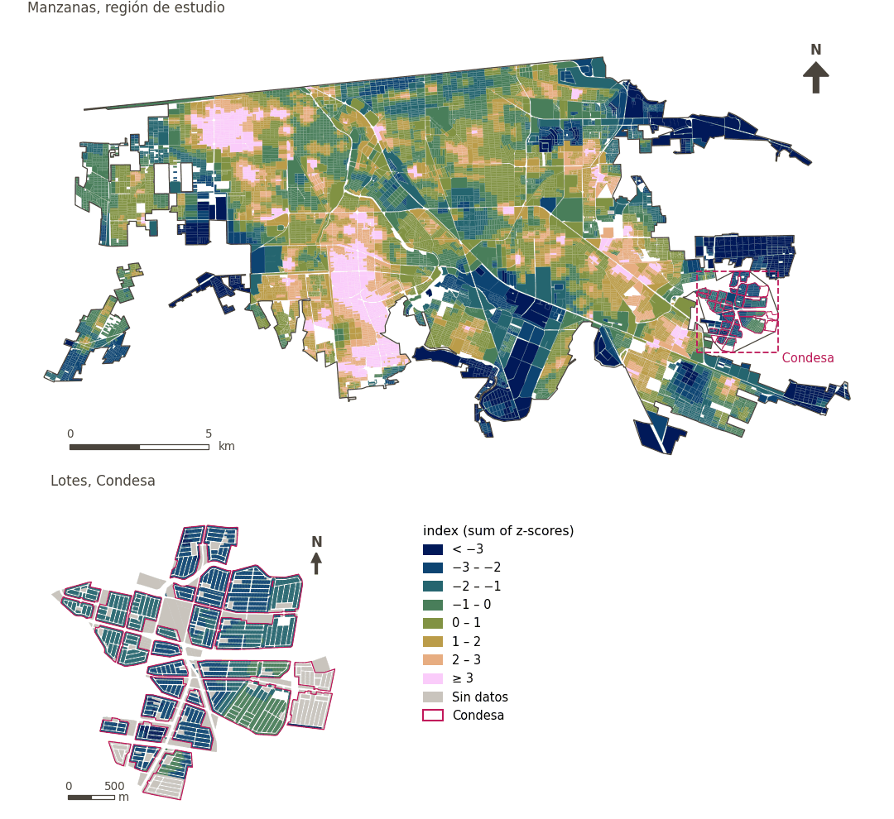

# Caminabilidad a 300 m y sus componentes

[← Volver al contenido](../README.md)

La caminabilidad del ULI sigue el índice de caminabilidad de GHSCI (Frank et al. 2010), con el puntaje de vida cotidiana juzgado a 300 m, la caminata de cinco minutos de la política de caminabilidad de Mexicali, en lugar de 500 m.

- **Vida cotidiana a 300 m** (`sp_walk_dl_300`): suma del acceso binario a 300 m a un mercado de alimentos frescos, una tienda de conveniencia (ambos de OpenStreetMap) y una parada de transporte público (IMIP u OpenStreetMap); de 0 a 3. Si falta cualquiera de los tres, el puntaje falta.
- **Densidad de población del vecindario** (`sp_local_nh_avg_pop_density`): para cada nodo, la media no ponderada de la densidad de población (personas/km²) de las celdas de 100 m que contienen algún nodo alcanzable a 1,000 m por la red; interpolada a cada punto según su posición en el tramo.
- **Densidad de intersecciones del vecindario** (`sp_local_nh_avg_intersection_density`): igual, con intersecciones por km² (intersecciones consolidadas de OSMnx con tolerancia de 12 m).
- **Caminabilidad** (`sp_walk_idx_300`): `W = z(DL) + z(densidad de población) + z(densidad de intersecciones)`, puntuaciones z con la desviación estándar muestral sobre todos los puntos de muestra urbanos con valor.
- **Caminabilidad atenuada por confort térmico** (`sp_walk_idx_300_tm`): `rango_percentil(W)·(1 − 0.5·h′)`, con `h′` el UTCI diurno medio reescalado de 30 a 50 °C y recortado a 0–1. El rango percentil promedia los empates y va de 0 a 1.

| Variable en puntos de muestra | Variable de área (valor medido) | Descripción | Región de estudio (Mexicali con Condesa) | Condesa |
|---|---|---|---|---|
| `sp_walk_dl_300` | `walk_dl_300` | Puntaje de vida diaria (300 m) | 0.300 | 0.016 |
| `sp_local_nh_avg_pop_density` | `local_nh_population_density` | Densidad de población del vecindario | 4,274 | 131 |
| `sp_local_nh_avg_intersection_density` | `local_nh_intersection_density` | Densidad de intersecciones del vecindario | 171 | 174 |
| `sp_walk_idx_300` | `walk_idx_300` | Caminabilidad (300 m) | 1.05 | −1.94 |
| `sp_walk_idx_300_tm` | `walk_idx_300_tm` | Caminabilidad (300 m) × confort térmico (atenuación) | 0.41 | 0.12 |

## Método: práctica

**Recetas:** [R1. Puntos de muestra y red peatonal](../03_recipes.md#r1), [R2. Distancia por la red al destino más cercano, censurada](../03_recipes.md#r2), [R3. Acceso por bandas y lejanía de una desamenidad](../03_recipes.md#r3), [R9. Caminabilidad y su atenuación por confort térmico](../03_recipes.md#r9)

**Configuración** ([`MX_Mexicali_2025_ULI.yml:909`](../../data/MX_Mexicali_2025_ULI.yml#L909)):

```yaml
walkability_variants:
  distances: [300]
  daily_living: [fresh_food_market, convenience, pt_any]
  heat:
    t: {variable: sp_utci_day_mean, range: [30, 50], label: {es: confort térmico, en: thermal comfort}}
  sets: [t]
  forms: [multiplicative]
  attenuation: 0.5
  percentiles: [5, 95]
```

**Código (GHSCI):**

- [`process/subprocesses/_11_neighbourhood_analysis.py:115`](https://github.com/healthysustainablecities/global-indicators/blob/f03909611dba336c2728fffab6d697779487d0b1/process/subprocesses/_11_neighbourhood_analysis.py#L115) `compute_nodes_pop_intersect_density()`
- [`process/subprocesses/_walkability_variants.py:243`](https://github.com/healthysustainablecities/global-indicators/blob/f03909611dba336c2728fffab6d697779487d0b1/process/subprocesses/_walkability_variants.py#L243) `zscore()`
- [`process/subprocesses/_walkability_variants.py:270`](https://github.com/healthysustainablecities/global-indicators/blob/f03909611dba336c2728fffab6d697779487d0b1/process/subprocesses/_walkability_variants.py#L270) `percentile_rank()`
- [`process/subprocesses/_walkability_variants.py:261`](https://github.com/healthysustainablecities/global-indicators/blob/f03909611dba336c2728fffab6d697779487d0b1/process/subprocesses/_walkability_variants.py#L261) `rescale()`
- [`process/subprocesses/_walkability_variants.py:275`](https://github.com/healthysustainablecities/global-indicators/blob/f03909611dba336c2728fffab6d697779487d0b1/process/subprocesses/_walkability_variants.py#L275) `compute_variants()`

## Lo usan

[Caminabilidad (300 m), atenuada por confort térmico](walkability.md)

## Resultados

| Medida | Región de estudio (Mexicali con Condesa) | Condesa |
|---|---|---|
| Valor de la región | 1.05 | −1.94 |
| Áreas con valor | 14,216 de 14,252 manzanas | 13,265 de 14,988 lotes |
| Mediana (P25–P75), ponderada | 0.824 (−0.124 – 1.94) | −2.02 (−2.36 – −1.58) |
| Rango | −5.59 – 7.01 | −4.26 – −0.363 |

*Distribuciones: manzanas de la región de estudio ponderadas por su población censal (2020); lotes de Condesa con igual peso (3.2 residentes supuestos por lote). Los valores de la región son los que GHSCI reporta para cada región en conjunto.*

## Mapa



*Mapa. Caminabilidad a 300 m y sus componentes: valor medido (index (sum of z-scores)) por manzana en la región de estudio y por lote en Condesa (recuadro). Clases del tablero; los colores favorables son los claros (mayor es mejor).*
